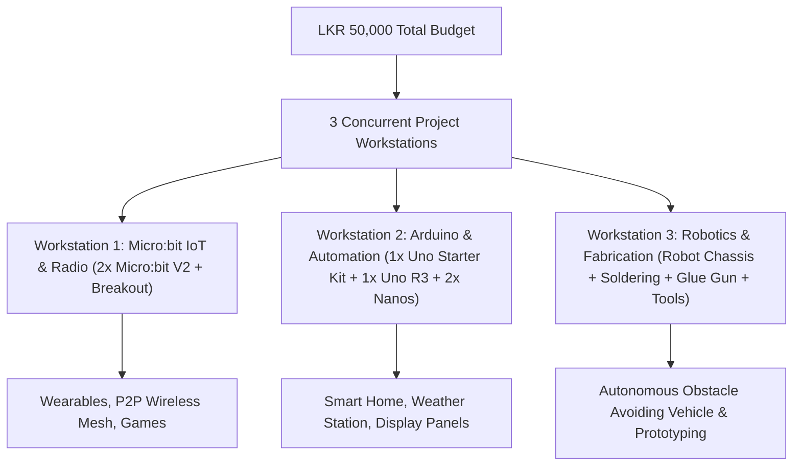
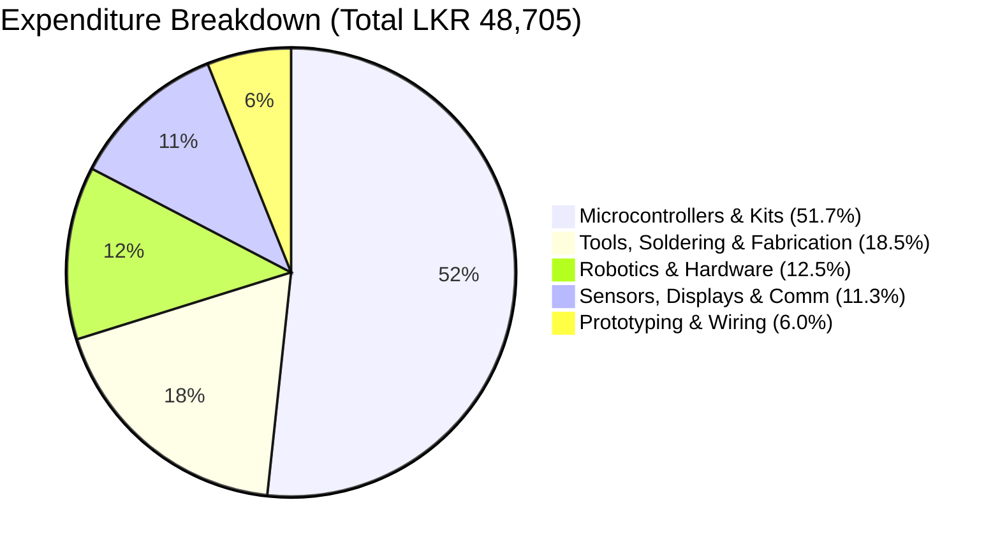

# School Electronics & Innovation Club: LKR 50,000 Procurement Plan & Starter Guide

**Target Institution:** School Electronics & Innovation Club (Starting from Scratch)  
**Budget Allocation:** LKR 50,000.00 (Inclusive of hardware, tools, and courier shipping)  
**Primary Supplier:** [Duino.lk](https://www.duino.lk/) (Kandy / Islandwide Delivery, Sri Lanka)  
**Target Beneficiaries:** 15–25 Students organized into 3 concurrent hands-on project teams  

---

## 1. Executive Summary & Club Architecture

When establishing a school electronics and innovation club with zero existing inventory, the most critical objective is to **avoid single points of failure** (e.g., spending the entire budget on a single expensive robot that only one student can touch). 

This plan allocates the **LKR 50,000 budget** across a complete 3-tier ecosystem:
1. **Visual & Block Coding (Micro:bit):** Low learning curve for junior students (Grades 6–9) featuring onboard sensors, LED matrix, and wireless radio.
2. **Standard Embedded Systems (Arduino Uno & Nano):** Text-based C++ programming aligning with the Sri Lankan O/L & A/L ICT and technology streams.
3. **Hardware Workshop & Fabrication:** Essential safety tools (temperature-adjustable soldering iron, hot glue gun, multimeters, wire strippers) to turn breadboard circuits into physical inventions.



---

## 2. Complete Itemized Bill of Materials (BOM)

All items listed below have been verified with live catalog pricing on [Duino.lk](https://www.duino.lk/).

### Category A: Microcontrollers & Core Starter Kits (LKR 25,180.00)
| Product Name & Direct Store Link | Unit Price (LKR) | Qty | Subtotal (LKR) | Educational Justification |
| :--- | :---: | :---: | :---: | :--- |
| [Micro:bit V2 BBC Official Board](https://www.duino.lk/product/microbit-v2-board/) | 6,250.00 | 2 | 12,500.00 | Built-in speaker, mic, touch sensor, accelerometer, and 2.4GHz radio. Having 2 units enables inter-board radio telemetry projects. |
| [Micro:bit V2 Extension Breakout Board](https://www.duino.lk/product/microbit-v2-extension-board-breakout-board/) | 1,990.00 | 1 | 1,990.00 | Bridges Micro:bit edge connector to standard breadboards and 3-pin servo headers. |
| [Battery Holder Case for Micro:bit (2x AAA 3V)](https://www.duino.lk/product/microbit-v2-go-microbit-bundle/) | 160.00 | 2 | 320.00 | Untethers Micro:bits from computer USB ports for portable / wearable experiments. |
| [O/L ICT Project Startup Kit 03 with Uno R3 & Box](https://www.duino.lk/product/arduino-starter-kit-03-for-school-ol-ict/) | 5,590.00 | 1 | 5,590.00 | Complete kit with Uno R3, plastic storage organizer, LEDs, resistors, buttons, and sensors matching school ICT syllabus. |
| [Arduino Compatible Uno R3 CH340G Board](https://www.duino.lk/product/arduino-compatible-r3-atmega328p-ch340g/) | 2,800.00 | 1 | 2,800.00 | Independent second Uno board so Team 2 can build full-sized projects concurrently. |
| [Arduino Compatible Nano V3.0 (Type-C USB Port)](https://www.duino.lk/product/arduino-compatible-nano-v3-0/) | 990.00 | 2 | 1,980.00 | Breadboard-friendly micro-form-factor Arduinos ideal for miniaturized and mobile builds. |

---

### Category B: Tools, Soldering & Fabrication (LKR 9,000.00)
| Product Name & Direct Store Link | Unit Price (LKR) | Qty | Subtotal (LKR) | Educational Justification |
| :--- | :---: | :---: | :---: | :--- |
| [Soldering Iron Kit 60W Adjustable with Accessories](https://www.duino.lk/product/soldering-iron-kit-60w-adjustable-with-accessories/) | 3,190.00 | 1 | 3,190.00 | Temperature-controlled iron (200°C–450°C), metal safety stand, 5 interchangeable tips, and zipper carry case. |
| [60W Electric Desoldering Pump Sucker CJ-019X](https://www.duino.lk/product/60w-electric-desoldering-pump/) | 1,090.00 | 1 | 1,090.00 | Heated vacuum tool to quickly correct beginners' soldering mistakes without burning pads. |
| [Solder Wire 1.0mm Tin Welding Wires 100g Spool](https://www.duino.lk/product/solder-wire-1-0mm-tin-welding-wires-100g/) | 1,390.00 | 1 | 1,390.00 | Ample spool of rosin-core solder wire to last two academic terms. |
| [60W Hot Melt Glue Gun SD-A6 (Brass Nozzle)](https://www.duino.lk/product/60w-glue-gun-nozzle-sd-a6/) | 1,390.00 | 1 | 1,390.00 | Industrial-grade rapid bonding tool for robot chassis, cardboard modeling, and mounting sensors. |
| [Hot Glue Adhesive Sticks 7mm × 300mm](https://www.duino.lk/product/clear-glue-adhesive-sticks-for-hot-glue-gun-10mmx180mm/) | 30.00 | 10 | 300.00 | Long 300mm glue stick refills. |
| [Wire Stripper Crimper Cutter Pliers 10-22 AWG](https://www.duino.lk/product/wire-stripper-crimper-cutter-pliers/) | 860.00 | 1 | 860.00 | High-precision gauge notches allow students to strip hookup wires cleanly without severing internal strands. |
| [Digital Multimeter DT-830D with Test Leads](https://www.duino.lk/product/digital-multimeter-dt-830d/) | 890.00 | 2 | 1,780.00 | 2 multimeters allow both testing stations to diagnose continuity, battery voltage, and circuit current simultaneously. |

---

### Category C: Prototyping & Connectivity (LKR 2,950.00)
| Product Name & Direct Store Link | Unit Price (LKR) | Qty | Subtotal (LKR) | Educational Justification |
| :--- | :---: | :---: | :---: | :--- |
| [Breadboard 830 Tie Point (Full Size)](https://www.duino.lk/product/breadboard-830-tie-point-16-5x5-5x0-85-cm/) | 265.00 | 4 | 1,060.00 | Full-length breadboards with dual power rails for solderless prototyping. |
| [Breadboard Mini 170 Tie-points](https://www.duino.lk/product/breadboard-mini-170-tie-points/) | 75.00 | 4 | 300.00 | Compact sub-boards for daughter modules, robot shields, and small IC tests. |
| [5V/3.3V Dedicated Breadboard Power Supply Module](https://www.duino.lk/product/5v-3-3v-breadboard-dedicated-power-module/) | 425.00 | 2 | 850.00 | Plugs directly onto 830-point breadboard rails; prevents students from overloading Arduino 5V/3.3V regulators. |
| [Male to Male Jumper Wires 20cm (40 pcs)](https://www.duino.lk/product/jumper-wire-male-to-male-20cm-40pcs/) | 190.00 | 2 | 380.00 | 80 high-flex jumper cables for breadboard interconnections. |
| [Male to Female Jumper Wires 20cm (40 pcs)](https://www.duino.lk/product/jumper-wire-male-to-female-20cm-40pcs/) | 180.00 | 2 | 360.00 | 80 jumper cables for connecting microcontrollers to breakout pins and sensor headers. |
| [Female to Female Jumper Wires 20cm (40 pcs)](https://www.duino.lk/product/jumper-wire-female-to-female-20cm-40pcs/) | 180.00 | 2 | 360.00 | 80 jumper cables for direct module-to-module interconnection. |

---

### Category D: Sensors, Displays & Communication (LKR 5,505.00)
| Product Name & Direct Store Link | Unit Price (LKR) | Qty | Subtotal (LKR) | Educational Justification |
| :--- | :---: | :---: | :---: | :--- |
| [HC-SR04 Ultrasonic Distance Sensor](https://www.duino.lk/product/ultrasonic-distance-measuring-transducer/) | 275.00 | 3 | 825.00 | High-accuracy sonar distance measurement for robot navigation, smart dustbins, and security gates. |
| [SG90 9g Micro Servo Motor](https://www.duino.lk/product/servo-motor-sg90-9g/) | 350.00 | 4 | 1,400.00 | 180-degree position control for robotic arms, steering mechanisms, pan-tilt radars, and automated flaps. |
| [LCD 16x2 Character Display (Blue Backlight)](https://www.duino.lk/product/lcd-16x02-display-blue/) | 380.00 | 2 | 760.00 | Visual readout for student projects (scores, sensor readings, system alerts). |
| [I2C Serial Interface Adapter for 1602 LCD](https://www.duino.lk/product/iici2c-twi-spi-serial-interface-module-for-1602-1604-2004lcd/) | 210.00 | 2 | 420.00 | Shrinks complex 16-pin LCD wiring down to just 2 communication pins (SDA & SCL). |
| [DHT11 Temperature & Relative Humidity Sensor](https://www.duino.lk/product/dht11-temperature-and-humidity-sensor-module/) | 230.00 | 2 | 460.00 | Digital sensor for indoor weather stations and greenhouse automation prototypes. |
| [LDR Light Sensitive Photoresistor Module](https://www.duino.lk/product/photoresistor-ldr-light-sensitive-sensor-module/) | 130.00 | 2 | 260.00 | Digital + analog output sensor for automated solar tracking and automatic street lamps. |
| [5V 1-Channel Relay Module with Optocoupler](https://www.duino.lk/product/relay-board-module-5v-1-channel/) | 220.00 | 2 | 440.00 | Safe electrical isolation for switching high-load components (bulbs, 12V motors, water pumps). |
| [Piezo Electronic Buzzer Alarm (DC 3-24V)](https://www.duino.lk/product/dc-3-24v-electronic-buzzer/) | 290.00 | 2 | 580.00 | Audible output for sirens, Morse code generators, and game buzzers. |
| [HC-06 Bluetooth RF Transceiver Module](https://www.duino.lk/product/hc-06-bluetooth-rf-transceiver-module-slave/) | 780.00 | 1 | 780.00 | Links Arduino to student Android smartphones for remote-control vehicle apps and wireless telemetry. |

---

### Category E: Robotics Chassis & Passives (LKR 6,070.00)
| Product Name & Direct Store Link | Unit Price (LKR) | Qty | Subtotal (LKR) | Educational Justification |
| :--- | :---: | :---: | :---: | :--- |
| [Duino Obstacle Avoidance Smart Robot Car Kit](https://www.duino.lk/product/duino-obstacle-avoidance-smart-robot-car-kit/) | 1,990.00 | 1 | 1,990.00 | Includes transparent acrylic chassis, 2x TT geared DC motors, 2x rubber wheels, caster wheel, and hardware. |
| [L298N Dual H-Bridge Motor Driver Controller](https://www.duino.lk/product/l298n-dual-h-bridge-dc-stepper-motor-driver/) | 450.00 | 2 | 900.00 | Robust dual motor controller capable of driving two DC motors bidirectionally with PWM speed control. |
| [Assorted 5mm Diffused LEDs (Pack of 20)](https://www.duino.lk/product/1000pcs-3mm-red-water-clear-led-1-9-2-1vdc-packet/) | 35.00 | 20 | 700.00 | Multi-colored indicators (Red, Green, Yellow, Blue) for basic logic and circuit experiments. |
| [1/4W Metal Film Resistors (220Ω, 1kΩ, 10kΩ - 50 pcs)](https://www.duino.lk/product/2k-ohm-1-4w-smd-resistor-1206/) | 5.00 | 50 | 250.00 | Standard breadboard resistors for LED current limiting and digital pull-up/pull-down circuits. |
| [Tactile Push Buttons 12×12×7.3mm (10 pcs)](https://www.duino.lk/product/tactile-push-button-switch-4pins-12x12x7-3mm/) | 30.00 | 10 | 300.00 | Breadboard-friendly momentary switches for student game controllers and manual overrides. |
| [9V Battery Snap-on Connector Clips (6 pcs)](https://www.duino.lk/product/9v-battery-snap-on-connector-clip/) | 25.00 | 6 | 150.00 | DC barrel and lead clips to power breadboard modules and Arduino away from wall sockets. |

---

## 3. Financial Summary & Budget Balance



| Budget Item | Amount (LKR) |
| :--- | :---: |
| Approved Total Club Budget | **50,000.00** |
| Total Hardware & Components Cost (34 Line Items) | **48,705.00** |
| Remaining Balance for Courier Delivery (PromptX / Domex) | **1,295.00** |
| **Net Variance** | **LKR 0.00 (Balanced)** |

---

## 4. Workstation Operational Architecture

To ensure high student engagement, organize club meetings into three specialized stations that rotate weekly:

```
+---------------------------------------------------------------------------------------------------+
|                                  INNOVATION CLUB FLOOR PLAN                                       |
+------------------------------------+----------------------------------+---------------------------+
| STATION 1: Micro:bit & Wireless    | STATION 2: Arduino Automation    | STATION 3: Fabrication    |
| - 2x BBC Micro:bit V2              | - 1x Uno Startup Kit (Boxed)     | - 60W Soldering Station   |
| - 1x Breakout Expansion Board      | - 1x Uno R3 Standalone           | - Desoldering Pump & Wire |
| - 2x AAA Battery Packs             | - 2x Nano V3.0 Type-C            | - 60W Hot Melt Glue Gun   |
| - 2x Full Breadboards + Jumpers    | - 2x 16x2 I2C LCDs               | - Wire Stripper / Cutter  |
| - Focus: Block Coding & P2P Radio  | - DHT11, Relays, LDR, Buzzers    | - 2x Digital Multimeters  |
|                                    | - Focus: C++ Embedded Code       | - Duino Smart Car Chassis |
+------------------------------------+----------------------------------+---------------------------+
```

---

## 5. Master Catalog of 20 Hands-On Club Projects

Each project has a dedicated, self-contained guide with complete schematics, bill of materials, circuit wiring tables, source code, and step-by-step instructions.

| # | Project Title & Guide Link | Platform | Difficulty | Core Components |
| :-: | :--- | :--- | :---: | :--- |
| **01** | [Two-Way Pocket Radio Messenger](projects/project-01-microbit-radio-chat.md) | BBC Micro:bit | Beginner | 2x Micro:bit V2, 2.4GHz RF Radio |
| **02** | [Digital Compass & Hiking Pedometer](projects/project-02-microbit-digital-compass-step-counter.md) | BBC Micro:bit | Beginner | Micro:bit V2 Magnetometer & Accelerometer |
| **03** | [Classroom Noise Sentry & Sound Meter](projects/project-03-microbit-sound-level-meter-noise-cop.md) | BBC Micro:bit | Beginner | Micro:bit V2 MEMS Mic & 5x5 LED Matrix |
| **04** | [Tilt-Controlled Maze Game with Audio FX](projects/project-04-microbit-tilt-maze-game.md) | BBC Micro:bit | Intermediate | Micro:bit V2 Accelerometer & Speaker |
| **05** | [Servo-Driven Analog Dial Gauge](projects/project-05-microbit-servo-robotic-gauge.md) | Micro:bit + Servo | Intermediate | Micro:bit V2, Breakout Board, SG90 Servo |
| **06** | [Four-Way Traffic Light with Pedestrian Crossing](projects/project-06-traffic-light-controller.md) | Arduino Nano | Beginner | Red/Yellow/Green LEDs, Button, Buzzer |
| **07** | [Automatic Dusk-to-Dawn Street Lamp with Relay](projects/project-07-smart-street-light-ldr.md) | Arduino Uno | Beginner | LDR Sensor Module, 5V Opto-Relay, LED |
| **08** | [Formula 1 Reaction Speed Tester](projects/project-08-digital-stopwatch-reaction-timer.md) | Arduino Uno | Beginner | 5x Red LEDs, 2x Push Buttons, Buzzer |
| **09** | [Audio-Visual Morse Code Keyer & Decoder](projects/project-09-morse-code-trainer.md) | Arduino Nano | Intermediate | Push Button Key, Piezo Buzzer, LED |
| **10** | [Ultrasonic Tripwire Security Alarm](projects/project-10-intruder-security-alarm.md) | Arduino Nano | Intermediate | HC-SR04 Sonar, Piezo Siren, Dual LEDs |
| **11** | [Indoor Weather Station with 16x2 I2C LCD](projects/project-11-indoor-weather-station-lcd.md) | Arduino Uno | Intermediate | DHT11 Sensor, 1602 LCD, I2C Backpack |
| **12** | [Ultrasonic Digital Measuring Tape with LCD](projects/project-12-ultrasonic-digital-measuring-tape.md) | Arduino Uno | Intermediate | HC-SR04 Sonar, 1602 LCD, Push Button |
| **13** | [Touchless Smart Dustbin with Servo Lid](projects/project-13-touchless-smart-dustbin.md) | Arduino Nano | Intermediate | HC-SR04 Sonar, SG90 Servo, Hot Glue Gun |
| **14** | [Smart Car Park Barrier Gate with Sonar](projects/project-14-automatic-parking-barrier-gate.md) | Arduino Uno | Intermediate | HC-SR04 Sonar, SG90 Servo, Dual LEDs |
| **15** | [Acoustic Secret Knock Lock Detector](projects/project-15-secret-knock-detector.md) | Arduino Uno | Advanced | Piezo Vibration Sensor, SG90 Servo Lock |
| **16** | [Dual DC Motor Controller with L298N](projects/project-16-dual-motor-speed-controller.md) | Arduino Uno | Intermediate | L298N Driver, 2x TT Geared DC Motors |
| **17** | [Autonomous Obstacle-Avoiding Smart Rover](projects/project-17-autonomous-obstacle-avoiding-rover.md) | Arduino Uno | Advanced | 2WD Chassis, L298N, HC-SR04, Panning Servo |
| **18** | [Bluetooth Smartphone Remote-Controlled Car](projects/project-18-bluetooth-smartphone-rc-car.md) | Arduino Uno | Advanced | 2WD Chassis, L298N, HC-06 Bluetooth |
| **19** | [Dual-LDR Single-Axis Solar Tracker](projects/project-19-dual-ldr-solar-tracker.md) | Arduino Nano | Advanced | 2x LDR Modules, SG90 Servo, Sun Vane |
| **20** | [Soldering Workshop 101: Cable Continuity Tester Box](projects/project-20-workshop-continuity-tester-soldering-bench.md) | Workshop Tools | Intermediate | 60W Soldering Iron, Multimeter, Desoldering Pump |


---

## 6. Safety & Lab Protocol Guidelines

> [!CAUTION]
> **Soldering & Thermal Safety:**
> - Soldering irons operate between **300°C–400°C**. Designate a single, fire-retardant "Soldering Zone" away from common walkways.
> - The soldering iron must always rest on its metal stand when not actively in a student's hand. Never lay it directly on tables.
> - Provide safety goggles during soldering and wire cutting to protect against flying wire clippings and solder flux splashes.
> - Wash hands thoroughly after handling solder wire (contains tin and flux rosin).

> [!TIP]
> **Component Longevity & Care:**
> - Keep electrolytic capacitors, LEDs, and ICs separated inside the included compartmentalized storage box.
> - Never connect 9V batteries directly to the 5V or 3.3V power rails without using the regulated [Breadboard Power Supply Module](https://www.duino.lk/product/5v-3-3v-breadboard-dedicated-power-module/).
> - Instruct students to disconnect power *before* changing any wiring on breadboards to prevent accidental short circuits.

---

## 7. Ordering & Procurement Instructions for Duino.lk

1. **Ordering Method:** Add all 34 line items directly to the cart at [Duino.lk](https://www.duino.lk/).
2. **School Purchase Orders & Invoicing:** If the school requires an official quotation or formal commercial invoice for voucher clearance, contact Duino.lk directly via their official WhatsApp desk at **`071 21 21 767`** or phone **`071 036 0355`** before placing the order.
3. **Payment Methods:**
   - Online Card Payment (Visa / MasterCard)
   - Direct Bank Transfer (Commercial Bank / Sampath Bank / BOC)
   - Cash on Delivery (COD available for most postal codes across Sri Lanka)
4. **Delivery Timeframe:** Standard domestic courier dispatch takes 2–4 business days islandwide.
