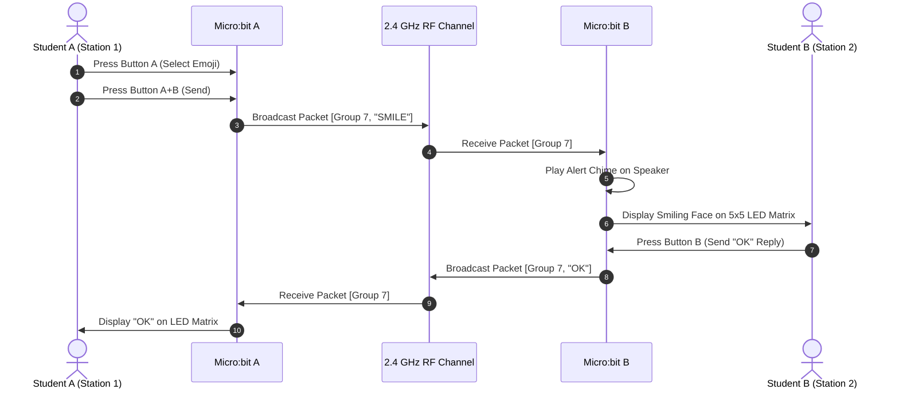

# Project 01: Two-Way Pocket Radio Messenger

**Track:** BBC Micro:bit Interactive Computing  
**Difficulty Level:** Beginner (Grades 6–9)  
**Estimated Time:** 45–60 Minutes  
**Target Group:** 2–4 Students (Working in pairs)  

---

## 1. Project Overview
In this project, students use two BBC Micro:bit V2 boards to build a bidirectional wireless text and emoji messenger. Using the Micro:bit's built-in 2.4 GHz radio transceiver, each device acts as both a transmitter and a receiver. Students can select pre-programmed messages or emojis using physical buttons and transmit them wirelessly through the air across classroom distances (up to 20–30 meters indoors).



---

## 2. Learning Objectives (STEM Concepts)
- **Computer Science:** Radio networking concepts (channels, packets, broadcasting vs. addressing, packet sniffing).
- **Physics:** High-frequency electromagnetic waves (2.4 GHz ISM band), antenna propagation, signal attenuation.
- **Electronics:** On-board SoC (Nordic nRF52833) wireless transceiver architecture, battery management.

---

## 3. Bill of Materials (From Club Inventory)
| Item | Quantity | Source / Link |
| :--- | :---: | :--- |
| BBC Micro:bit V2 Board | 2 | [Duino.lk Micro:bit V2](https://www.duino.lk/product/microbit-v2-board/) |
| AAA Battery Holder (2x AAA 3V) | 2 | [Duino.lk Battery Holder](https://www.duino.lk/product/microbit-v2-go-microbit-bundle/) |
| AAA Alkaline Batteries (1.5V) | 4 | Club Consumables |
| Micro-USB Programming Cable | 1 | Supplied with starter kit |

---

## 4. Hardware Setup
No external wiring or breadboard is required for this foundational project! Both Micro:bits use their built-in components:
- **Button A:** Cycles through message selections.
- **Button B:** Cycles backwards.
- **Button A + B:** Transmits the active selection.
- **Built-in Speaker:** Sounds an alert tone upon packet arrival.
- **5x5 LED Matrix:** Visualizes incoming texts and icons.

Plug the 2x AAA battery pack into the white JST battery socket on the back of each Micro:bit to make them fully portable.

---

## 5. Source Code

### MakeCode Python (or upload via MakeCode Block Editor at makecode.microbit.org)

```python
# Project 01: Micro:bit Two-Way Radio Messenger
# Upload this identical script to both Micro:bit A and Micro:bit B

radio.set_group(7)           # Use a unique group number (1-255) for your club pair
radio.set_transmit_power(7)  # Maximum transmission range (0 to 7)

messages = ["HELLO!", "YES", "NO", "HELP", "MEET ME", "GAME ON"]
selected_index = 0

def on_received_string(receivedString):
    # Play chime alert through the built-in speaker
    music.play(music.builtin_playable_sound(SoundExpression.HAPPY), music.PlaybackMode.IN_BACKGROUND)
    # Scroll the incoming message on the 5x5 LED matrix
    basic.show_string(receivedString)
    basic.pause(500)
    basic.clear_screen()
radio.on_received_string(on_received_string)

def on_received_value(name, value):
    # Handle incoming emoji codes
    music.play(music.tone_playable(880, music.beat(BeatFraction.EIGHTH)), music.PlaybackMode.UNTIL_DONE)
    if name == "EMOJI":
        if value == 1:
            basic.show_icon(IconNames.HAPPY)
        elif value == 2:
            basic.show_icon(IconNames.HEART)
        elif value == 3:
            basic.show_icon(IconNames.SURPRISED)
        basic.pause(1000)
        basic.clear_screen()
radio.on_received_value(on_received_value)

def on_button_pressed_a():
    global selected_index
    selected_index = (selected_index + 1) % len(messages)
    basic.show_string(messages[selected_index])
input.on_button_pressed(Button.A, on_button_pressed_a)

def on_button_pressed_b():
    # Send quick happy emoji icon
    radio.send_value("EMOJI", 1)
    basic.show_icon(IconNames.HAPPY)
    basic.pause(400)
    basic.clear_screen()
input.on_button_pressed(Button.B, on_button_pressed_b)

def on_button_pressed_ab():
    # Transmit the selected text message
    radio.send_string(messages[selected_index])
    basic.show_icon(IconNames.YES)
    basic.pause(400)
    basic.clear_screen()
input.on_button_pressed(Button.AB, on_button_pressed_ab)

# On Start indicator
basic.show_icon(IconNames.HEART)
basic.pause(400)
basic.clear_screen()
```

---

## 6. Step-by-Step Testing & Operation
1. Plug Micro:bit A into the computer via USB and go to [makecode.microbit.org](https://makecode.microbit.org).
2. Paste the code, flash it to Micro:bit A, then plug in Micro:bit B and flash the identical code.
3. Disconnect both from USB and plug in their AAA battery packs.
4. Give Micro:bit A to Student A and Micro:bit B to Student B across the room.
5. Press **Button A** on Unit A to cycle messages (`HELLO`, `YES`, `NO`).
6. Press **Button A+B** together to transmit. Unit B will chime and scroll the message!
7. Press **Button B** on either unit to instantly send a smiling face emoji.

---

## 7. Troubleshooting Checklist
- **No response on receiving unit?** Check that both devices are set to the exact same `radio.set_group()` number. If another club team is in the room, assign each pair their own group number (e.g., Team 1 uses group 7, Team 2 uses group 12).
- **Faint LED display?** The AAA batteries are low. Measure voltage using the club's [Digital Multimeter DT-830D](https://www.duino.lk/product/digital-multimeter-dt-830d/). Each cell should read > 1.3V (2.6V total).

---

## 8. Innovation & Extension Challenges
1. **Morse Code Messenger:** Modify the code so pressing Button A sends a short "dit" tone and Button B sends a long "dah" tone.
2. **Encrypted Channel:** Add a simple Caesar cipher algorithm that shifts characters by +3 before sending, and decodes them on the receiver.
3. **RSSI Signal Radar:** Read `radio.received_packet(RadioPacketProperty.SIGNAL_STRENGTH)` to create a "hot or cold" beacon tracker for a classroom treasure hunt game!
