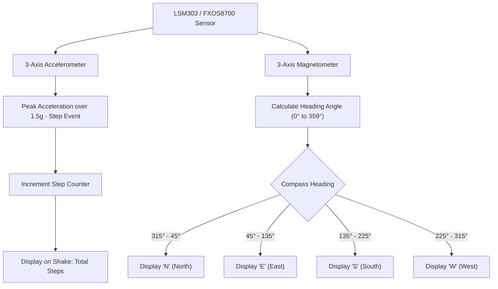

# Project 02: Digital Compass & Hiking Pedometer

**Track:** BBC Micro:bit Interactive Computing  
**Difficulty Level:** Beginner to Intermediate (Grades 6–9)  
**Estimated Time:** 45 Minutes  
**Target Group:** 1–2 Students  

---

## 1. Project Overview
The BBC Micro:bit V2 contains an integrated combined sensor IC: an accelerometer (measuring gravitational force across 3 axes) and a magnetometer (measuring magnetic field strength in microteslas). In this project, students construct a wearable outdoor adventure tool that functions simultaneously as a digital navigation compass and an automatic step-counter (pedometer).



---

## 2. Learning Objectives (STEM Concepts)
- **Physics & Earth Science:** Earth's geomagnetic field, magnetic declination, calibration against local magnetic noise.
- **Kinematics:** Acceleration vectors, dynamic vs. static forces, threshold-based peak detection.
- **Mathematics:** Angular geometry, mapping 360-degree compass bearings into discrete 8-cardinal quadrant ranges.

---

## 3. Bill of Materials
| Item | Quantity | Source / Link |
| :--- | :---: | :--- |
| BBC Micro:bit V2 Board | 1 | [Duino.lk Micro:bit V2](https://www.duino.lk/product/microbit-v2-board/) |
| AAA Battery Holder (2x AAA 3V) | 1 | [Duino.lk Battery Holder](https://www.duino.lk/product/microbit-v2-go-microbit-bundle/) |
| Rubber band or Velcro Strap | 1 | Club Consumables (Wearable wrist/shoe mount) |

---

## 4. Hardware Setup
No external wiring needed! Power the Micro:bit using the portable AAA battery pack. Strap the unit securely to your wrist or ankle using a velcro strap or rubber band.

---

## 5. Source Code (MakeCode Python)

```python
# Project 02: Digital Compass & Hiking Pedometer
steps = 0
mode = "COMPASS"  # Modes: 'COMPASS' or 'PEDOMETER'

# Calibrate the magnetic sensor on startup
input.calibrate_compass()
basic.show_string("READY")
basic.clear_screen()

def on_gesture_shake():
    global steps
    steps += 1
    # Emit subtle click tone through speaker
    music.play(music.tone_playable(523, music.beat(BeatFraction.SIXTEENTH)), music.PlaybackMode.IN_BACKGROUND)
input.on_gesture(Gesture.SHAKE, on_gesture_shake)

def on_button_pressed_a():
    global mode
    mode = "COMPASS"
    basic.show_string("C")
    basic.pause(300)
input.on_button_pressed(Button.A, on_button_pressed_a)

def on_button_pressed_b():
    global mode
    mode = "PEDOMETER"
    basic.show_string("P")
    basic.pause(300)
input.on_button_pressed(Button.B, on_button_pressed_b)

def on_logo_touched():
    # Touch gold logo on Micro:bit V2 to view exact numerical step count
    basic.show_number(steps)
input.on_logo_event(TouchButtonEvent.PRESSED, on_logo_touched)

def on_forever():
    if mode == "COMPASS":
        heading = input.compass_heading()
        if heading < 22.5 or heading >= 337.5:
            basic.show_string("N")
        elif heading >= 22.5 and heading < 67.5:
            basic.show_arrow(ArrowNames.NORTH_EAST)
        elif heading >= 67.5 and heading < 112.5:
            basic.show_string("E")
        elif heading >= 112.5 and heading < 157.5:
            basic.show_arrow(ArrowNames.SOUTH_EAST)
        elif heading >= 157.5 and heading < 202.5:
            basic.show_string("S")
        elif heading >= 202.5 and heading < 247.5:
            basic.show_arrow(ArrowNames.SOUTH_WEST)
        elif heading >= 247.5 and heading < 292.5:
            basic.show_string("W")
        elif heading >= 292.5 and heading < 337.5:
            basic.show_arrow(ArrowNames.NORTH_WEST)
    elif mode == "PEDOMETER":
        # In pedometer mode, show a pulsing walking dot
        led.plot(2, 2)
        basic.pause(200)
        led.unplot(2, 2)
        basic.pause(200)

basic.forever(on_forever)
```

---

## 6. Testing & Calibration
1. When first powered, the Micro:bit will display **"TILT TO FILL SCREEN"**. Tilt the board in all directions like a marble maze until all 25 LEDs light up; this calibrates the compass against local magnetic fields.
2. Press **Button A** to enter Compass mode. Rotate slowly—notice how the screen reliably tracks **N**, **E**, **S**, and **W**.
3. Press **Button B** to switch to Pedometer mode. Take 20 normal walking paces.
4. Tap the **golden Micro:bit logo** at the top: the board will scroll your exact step count!

---

## 7. Troubleshooting Checklist
- **Compass calibration loop repeats forever?** Move away from metal desks, steel beams, or power transformers that distort the magnetic field.
- **Steps registering when standing still?** The sensitivity threshold is too low. In MakeCode, adjust the acceleration trigger to check `input.acceleration(Dimension.STRENGTH) > 1600` instead of simple shake.

---

## 8. Innovation Challenges
1. **Calorie Burn Calculator:** Multiply steps by average stride length (0.7m) to display total distance traveled in meters and estimated energy burned in kilocalories.
2. **True North Correction:** Add an offset variable to correct for magnetic declination in Sri Lanka (~ -2° West).
