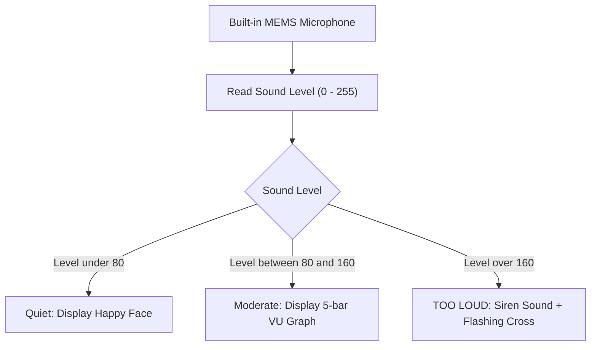

# Project 03: Classroom Noise Sentry & Sound Level Meter

**Track:** BBC Micro:bit Interactive Computing  
**Difficulty Level:** Beginner (Grades 6–8)  
**Estimated Time:** 45 Minutes  
**Target Group:** 1–3 Students  

---

## 1. Project Overview
The BBC Micro:bit V2 has a built-in MEMS microphone with an accompanying red LED on the front face that illuminates when the microphone is listening. In this project, students build a visual noise monitor for classrooms, study halls, or library environments. When sound levels stay in the acceptable zone, a cheerful face is shown. As ambient noise rises, a dynamic bar graph monitors intensity. If someone shouts or noise exceeds a set threshold, the Sentry triggers an alarm tone and displays a warning siren!



---

## 2. Learning Objectives (STEM Concepts)
- **Acoustics & Physics:** Sound waves, amplitude, decibels (dB), sound pressure levels, frequency perception.
- **Signal Processing:** Analog-to-digital conversion (ADC), continuous sampling, noise smoothing.
- **Human-Computer Interaction (HCI):** Real-time visual feedback, ambient warning systems.

---

## 3. Bill of Materials
| Item | Quantity | Source / Link |
| :--- | :---: | :--- |
| BBC Micro:bit V2 Board | 1 | [Duino.lk Micro:bit V2](https://www.duino.lk/product/microbit-v2-board/) |
| AAA Battery Holder (2x AAA 3V) | 1 | [Duino.lk Battery Holder](https://www.duino.lk/product/microbit-v2-go-microbit-bundle/) |
| Hot Glue Gun & Cardboard | 1 | [Duino.lk 60W Glue Gun](https://www.duino.lk/product/60w-glue-gun-nozzle-sd-a6/) (To build a desk stand) |

---

## 4. Hardware Setup
No external wiring required. The MEMS microphone, microphone LED, internal amplifier, and speaker are all integrated directly onto the Micro:bit V2 PCB.

Use the club's hot glue gun and clean cardboard scraps to construct a decorative desk stand shaped like an owl or a traffic light to mount the Micro:bit at the front of the classroom.

---

## 5. Source Code (MakeCode Python)

```python
# Project 03: Classroom Noise Level Sentry
noise_threshold = 150  # Adjust between 0 and 255 depending on classroom ambient noise
alarm_count = 0

def on_loud_sound():
    global alarm_count
    alarm_count += 1
    # Sound audible warning buzzer
    music.play(music.builtin_playable_sound(SoundExpression.YAWN), music.PlaybackMode.IN_BACKGROUND)
    for _ in range(3):
        basic.show_icon(IconNames.NO)
        basic.pause(150)
        basic.clear_screen()
        basic.pause(100)
input.on_sound(DetectedSound.LOUD, on_loud_sound)

# Set the sound threshold trigger
input.set_sound_threshold(SoundThreshold.LOUD, noise_threshold)

def on_button_pressed_a():
    # Adjust sensitivity: more sensitive (lower threshold)
    global noise_threshold
    noise_threshold = max(50, noise_threshold - 15)
    input.set_sound_threshold(SoundThreshold.LOUD, noise_threshold)
    basic.show_number(noise_threshold)
input.on_button_pressed(Button.A, on_button_pressed_a)

def on_button_pressed_b():
    # Adjust sensitivity: less sensitive (higher threshold)
    global noise_threshold
    noise_threshold = min(240, noise_threshold + 15)
    input.set_sound_threshold(SoundThreshold.LOUD, noise_threshold)
    basic.show_number(noise_threshold)
input.on_button_pressed(Button.B, on_button_pressed_b)

def on_logo_touched():
    # Display total number of noise violations recorded
    basic.show_string("VIOLATIONS:")
    basic.show_number(alarm_count)
input.on_logo_event(TouchButtonEvent.PRESSED, on_logo_touched)

def on_forever():
    current_level = input.sound_level()
    # Plot real-time bar graph on the 5x5 matrix
    led.plot_bar_graph(current_level, 200)
    basic.pause(50)

basic.forever(on_forever)
```

---

## 6. Step-by-Step Testing
1. Flash the code to the Micro:bit V2.
2. In a quiet room, observe the bottom row of LEDs on the 5x5 matrix showing just 1 or 2 lit LEDs.
3. Speak at conversational volume: the bar graph rises to 2–3 rows.
4. Clap loudly or yell near the microphone: the red mic indicator flashes, the board emits an alarm tone, and the screen flashes an **"X"** icon.
5. Tap the touch logo on the board to audit how many times the class exceeded the noise threshold during the session.

---

## 7. Innovation Challenges
1. **Networked Quiet-Zone:** Have the Sentry broadcast a radio packet using `radio.send_string("LOUD")` so that every student's individual desk Micro:bit flashes red in unison!
2. **Automatic Time-Out:** Add a timer that forces the display into a sad face for 30 seconds after a violation before resetting to the monitoring state.
