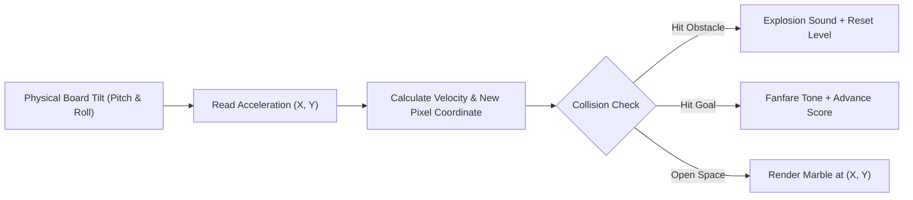

# Project 04: Tilt-Controlled Maze Game with Audio FX

**Track:** BBC Micro:bit Interactive Computing  
**Difficulty Level:** Intermediate (Grades 7–10)  
**Estimated Time:** 60 Minutes  
**Target Group:** 1–2 Students  

---

## 1. Project Overview
In this project, students program a video game on the Micro:bit that transforms the board into a handheld physics-based gaming console. Students control a bright pixel "marble" on the 5x5 LED screen by physically tilting the board in 3D space. The goal is to steer the marble past deadly "hole" obstacles to reach the blinking target goal while sound effects play through the built-in speaker.



---

## 2. Learning Objectives (STEM Concepts)
- **Computer Game Physics:** Simulating gravity, momentum, velocity damping, bounding box collisions.
- **Cartesian Coordinates:** Mapping continuous analog vectors (±1024 milli-g) onto a 5x5 discrete matrix grid (0,0 to 4,4).
- **Game Loops:** Frame rate management, non-blocking asynchronous audio synthesis.

---

## 3. Bill of Materials
| Item | Quantity | Source / Link |
| :--- | :---: | :--- |
| BBC Micro:bit V2 Board | 1 | [Duino.lk Micro:bit V2](https://www.duino.lk/product/microbit-v2-board/) |
| AAA Battery Holder (2x AAA 3V) | 1 | [Duino.lk Battery Holder](https://www.duino.lk/product/microbit-v2-go-microbit-bundle/) |

---

## 4. Hardware Setup
No external wiring. Powered portably by the 2x AAA battery pack.

---

## 5. Source Code (MakeCode Python)

```python
# Project 04: Tilt-Controlled Marble Maze Game
player_x = 0
player_y = 0
goal_x = 4
goal_y = 4
hazard_x = 2
hazard_y = 2
score = 0

def init_level():
    global player_x, player_y, goal_x, goal_y, hazard_x, hazard_y
    player_x = 0
    player_y = 0
    goal_x = randint(2, 4)
    goal_y = randint(2, 4)
    hazard_x = randint(1, 3)
    hazard_y = randint(1, 3)
    # Ensure hazard is not placed directly on player or goal
    if hazard_x == goal_x and hazard_y == goal_y:
        hazard_x = 1

init_level()

def on_forever():
    global player_x, player_y, score
    
    # Read tilt angles
    ax = input.acceleration(Dimension.X)
    ay = input.acceleration(Dimension.Y)
    
    # Move horizontally based on roll
    if ax > 250 and player_x < 4:
        player_x += 1
        music.play(music.tone_playable(262, music.beat(BeatFraction.SIXTEENTH)), music.PlaybackMode.IN_BACKGROUND)
    elif ax < -250 and player_x > 0:
        player_x -= 1
        music.play(music.tone_playable(262, music.beat(BeatFraction.SIXTEENTH)), music.PlaybackMode.IN_BACKGROUND)
        
    # Move vertically based on pitch
    if ay > 250 and player_y < 4:
        player_y += 1
        music.play(music.tone_playable(294, music.beat(BeatFraction.SIXTEENTH)), music.PlaybackMode.IN_BACKGROUND)
    elif ay < -250 and player_y > 0:
        player_y -= 1
        music.play(music.tone_playable(294, music.beat(BeatFraction.SIXTEENTH)), music.PlaybackMode.IN_BACKGROUND)
        
    # Check collision with Hazard
    if player_x == hazard_x and player_y == hazard_y:
        music.play(music.builtin_playable_sound(SoundExpression.SAD), music.PlaybackMode.UNTIL_DONE)
        basic.show_icon(IconNames.SKULL)
        basic.pause(600)
        score = 0
        init_level()
        return

    # Check collision with Goal
    if player_x == goal_x and player_y == goal_y:
        score += 1
        music.play(music.builtin_playable_sound(SoundExpression.HAPPY), music.PlaybackMode.UNTIL_DONE)
        basic.show_icon(IconNames.YES)
        basic.pause(400)
        init_level()
        return

    # Render Frame
    basic.clear_screen()
    # Plot goal (blinking slowly)
    led.plot_brightness(goal_x, goal_y, 100)
    # Plot hazard (dimly lit)
    led.plot_brightness(hazard_x, hazard_y, 40)
    # Plot player marble (brightest)
    led.plot_brightness(player_x, player_y, 255)
    
    basic.pause(180)  # Game frame refresh rate

basic.forever(on_forever)
```

---

## 6. Testing & Gameplay
1. Flash the game to the board. Hold the board flat horizontally in both palms.
2. The brightest LED is your marble; the dim LED is the hazard trap; the medium LED is your goal.
3. Gently tilt forward, back, left, and right to roll the marble.
4. Reach the goal to trigger victory audio and increase your score.
5. Hitting the hazard displays a skull and resets the game!

---

## 7. Innovation Challenges
1. **Multiplayer Marble Race:** Use the radio module so Player 1 and Player 2 race simultaneously on separate Micro:bits, with the first player to reach 5 points sending a game-over packet to freeze the opponent!
2. **Countdown Timer:** Add a 15-second survival timer that decreases the remaining time per level.
