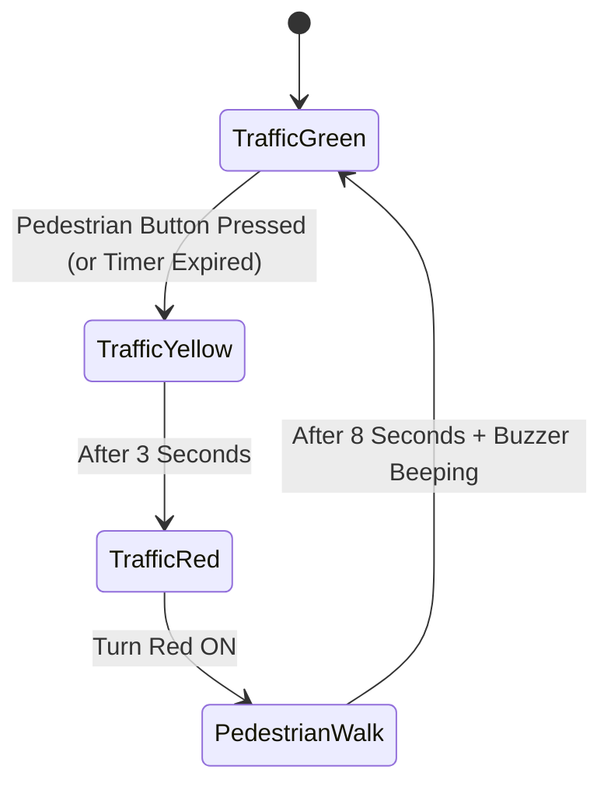

# Project 06: Four-Way Traffic Light with Pedestrian Crossing

**Track:** Foundational Arduino & Basic Electronics  
**Difficulty Level:** Beginner (Grades 6–9)  
**Estimated Time:** 60 Minutes  
**Target Group:** 2–3 Students  

---

## 1. Project Overview
Traffic light systems are the classic foundational project in embedded systems. In this project, students use an **Arduino Nano** or **Uno R3** on a breadboard to wire a multi-LED traffic signal sequence (Green -> Yellow -> Red). A momentary tactile push button acts as a pedestrian crossing request button. When pressed, the controller safely transitions the traffic lights to Red, sounds a pedestrian buzzer chime, and then resumes normal operation.



---

## 2. Learning Objectives (STEM Concepts)
- **Electronics Fundamentals:** LED polarity (Anode vs. Cathode), Ohm's Law ($V = IR$) for current-limiting resistors, switch pull-down circuits.
- **Embedded C++:** Digital I/O (`pinMode`, `digitalWrite`, `digitalRead`), state machine sequencing, non-blocking timing concepts.
- **Civic Engineering:** Municipal traffic flow logic, pedestrian safety systems.

---

## 3. Bill of Materials
| Item | Quantity | Source / Link |
| :--- | :---: | :--- |
| Arduino Compatible Nano V3.0 (Type-C) | 1 | [Duino.lk Nano V3.0](https://www.duino.lk/product/arduino-compatible-nano-v3-0/) |
| Breadboard 830 Tie Point | 1 | [Duino.lk Breadboard 830](https://www.duino.lk/product/breadboard-830-tie-point-16-5x5-5x0-85-cm/) |
| 5mm LEDs (1x Red, 1x Yellow, 1x Green) | 3 | [Duino.lk LEDs](https://www.duino.lk/product/1000pcs-3mm-red-water-clear-led-1-9-2-1vdc-packet/) |
| 220Ω Resistors (for LEDs) | 3 | [Duino.lk Resistors](https://www.duino.lk/product/2k-ohm-1-4w-smd-resistor-1206/) |
| 10kΩ Resistor (for Pull-Down) | 1 | [Duino.lk Resistors](https://www.duino.lk/product/2k-ohm-1-4w-smd-resistor-1206/) |
| Tactile Push Button 12x12mm | 1 | [Duino.lk Push Button](https://www.duino.lk/product/tactile-push-button-switch-4pins-12x12x7-3mm/) |
| Piezo Electronic Buzzer | 1 | [Duino.lk Buzzer](https://www.duino.lk/product/dc-3-24v-electronic-buzzer/) |
| Jumper Wires Male-to-Male | 10 | [Duino.lk Jumper Wires](https://www.duino.lk/product/jumper-wire-male-to-male-20cm-40pcs/) |

---

## 4. Circuit Diagram & Pinout Table

```
      +5V --- [Tactile Button] --- Pin D2 --- [10k Resistor] --- GND
      
      Pin D8  --- [220 Ohm] --->|--- (Green LED)   --- GND
      Pin D9  --- [220 Ohm] --->|--- (Yellow LED)  --- GND
      Pin D10 --- [220 Ohm] --->|--- (Red LED)     --- GND
      Pin D11 ---------------------- (+) Buzzer (-) --- GND
```

| Component | Pin Connected To | Rationale |
| :--- | :--- | :--- |
| **Green LED Anode** | Arduino **D8** via 220Ω | Active HIGH control |
| **Yellow LED Anode** | Arduino **D9** via 220Ω | Active HIGH control |
| **Red LED Anode** | Arduino **D10** via 220Ω | Active HIGH control |
| **Buzzer (+)** | Arduino **D11** | Audible pedestrian walking chirp |
| **Push Button** | Arduino **D2** (External Interruptible pin) | Digital input with 10kΩ pull-down to GND |

---

## 5. Arduino C++ Source Code

```cpp
/*
 * Project 06: Four-Way Traffic Light with Pedestrian Crossing
 * Club: School Electronics & Innovation Club
 */

const int PIN_GREEN   = 8;
const int PIN_YELLOW  = 9;
const int PIN_RED     = 10;
const int PIN_BUZZER  = 11;
const int PIN_BUTTON  = 2;

bool pedestrianRequested = false;

void setup() {
  pinMode(PIN_GREEN, OUTPUT);
  pinMode(PIN_YELLOW, OUTPUT);
  pinMode(PIN_RED, OUTPUT);
  pinMode(PIN_BUZZER, OUTPUT);
  pinMode(PIN_BUTTON, INPUT);

  // Initialize with Traffic Green ON
  digitalWrite(PIN_GREEN, HIGH);
  digitalWrite(PIN_YELLOW, LOW);
  digitalWrite(PIN_RED, LOW);
  digitalWrite(PIN_BUZZER, LOW);
}

void loop() {
  // Check if pedestrian pushed the button
  if (digitalRead(PIN_BUTTON) == HIGH) {
    pedestrianRequested = true;
  }

  // Normal Green Cycle (runs for 5 seconds unless button is pressed)
  for (int i = 0; i < 50; i++) {
    if (digitalRead(PIN_BUTTON) == HIGH) {
      pedestrianRequested = true;
    }
    delay(100);
  }

  // If pedestrian requested crossing, execute safe transition
  if (pedestrianRequested) {
    // 1. Transition: Green OFF, Yellow ON for 2.5s
    digitalWrite(PIN_GREEN, LOW);
    digitalWrite(PIN_YELLOW, HIGH);
    delay(2500);

    // 2. Yellow OFF, Red ON (Traffic Stopped)
    digitalWrite(PIN_YELLOW, LOW);
    digitalWrite(PIN_RED, HIGH);
    delay(1000);

    // 3. Pedestrian Walking Period: Beep buzzer intermittently
    for (int b = 0; b < 10; b++) {
      digitalWrite(PIN_BUZZER, HIGH);
      delay(200);
      digitalWrite(PIN_BUZZER, LOW);
      delay(400);
    }

    // 4. Return to normal: Red OFF, Green ON
    digitalWrite(PIN_RED, LOW);
    digitalWrite(PIN_GREEN, HIGH);
    pedestrianRequested = false;
    delay(3000); // Minimum green hold time
  }
}
```

---

## 6. Build & Troubleshooting Tips
- **LED doesn't light up?** Verify polarity. The longer lead is the positive Anode (connect to resistor and Arduino pin); the flat side of the lens is the negative Cathode (connect to GND).
- **Button triggers spontaneously?** Ensure the 10kΩ pull-down resistor connects between Pin D2 and GND. Without it, the pin "floats" and picks up electrical noise.

---

## 7. Innovation Challenges
1. Add an extra Red and Green LED pair to act as the explicit "Walk / Don't Walk" pedestrian sign.
2. Incorporate the club's [16x2 I2C LCD](https://www.duino.lk/product/lcd-16x02-display-blue/) to display a countdown timer: `"WALK: 10s... 9s..."`.
