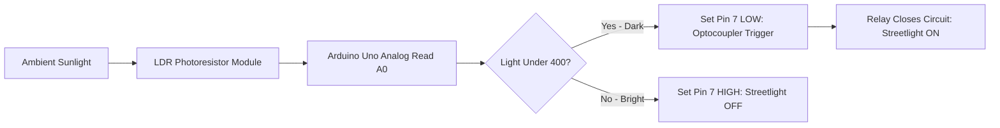

# Project 07: Automatic Dusk-to-Dawn Street Lamp with Relay

**Track:** Foundational Arduino & Basic Electronics  
**Difficulty Level:** Beginner to Intermediate (Grades 7–10)  
**Estimated Time:** 60 Minutes  
**Target Group:** 2 Students  

---

## 1. Project Overview
Automatic street lighting saves municipal energy by powering lights only when natural daylight drops below a critical lux threshold. In this project, students use an LDR (Light Dependent Resistor) module and an Arduino Uno to detect darkness. When twilight falls, the Arduino activates an optically isolated 5V relay module with a satisfying "click", lighting up the lamp and sounding a dusk notification!



---

## 2. Learning Objectives (STEM Concepts)
- **Photoelectric Effect & Semiconductors:** How cadmium sulfide (CdS) resistance changes dynamically with photon exposure.
- **Power Electronics & Isolation:** How an optocoupler and electromagnetic relay allow a delicate 5V microcontroller to safely switch high-power circuits without electrical feedback.
- **Hysteresis in Control Systems:** Implementing deadband thresholds in code to prevent rapid flicking at dusk.

---

## 3. Bill of Materials
| Item | Quantity | Source / Link |
| :--- | :---: | :--- |
| Arduino Compatible Uno R3 | 1 | [Duino.lk Uno R3](https://www.duino.lk/product/arduino-compatible-r3-atmega328p-ch340g/) |
| LDR Light Sensitive Sensor Module | 1 | [Duino.lk LDR Module](https://www.duino.lk/product/photoresistor-ldr-light-sensitive-sensor-module/) |
| 5V 1-Channel Relay Module | 1 | [Duino.lk Relay Module](https://www.duino.lk/product/relay-board-module-5v-1-channel/) |
| 5mm Yellow LED (Simulating streetlight) | 1 | [Duino.lk LEDs](https://www.duino.lk/product/1000pcs-3mm-red-water-clear-led-1-9-2-1vdc-packet/) |
| 220Ω Resistor | 1 | [Duino.lk Resistors](https://www.duino.lk/product/2k-ohm-1-4w-smd-resistor-1206/) |
| Male to Female Jumper Wires | 6 | [Duino.lk Jumper Wires](https://www.duino.lk/product/jumper-wire-male-to-female-20cm-40pcs/) |

---

## 4. Hardware Wiring & Pinout Table

| Module Pin | Arduino Uno Connection | Function |
| :--- | :--- | :--- |
| **LDR VCC** | 5V | Sensor power |
| **LDR GND** | GND | Ground |
| **LDR A0 (Analog Out)** | Analog Pin **A0** | Variable voltage 0–5V proportional to light |
| **Relay VCC** | 5V | Relay coil power |
| **Relay GND** | GND | Ground |
| **Relay IN** | Digital Pin **7** | Active LOW relay trigger |
| **Relay NO (Normally Open)** | To LED Anode via 220Ω | Switched load terminal |
| **Relay COM (Common)** | 5V | Common power rail |

---

## 5. Arduino C++ Source Code

```cpp
/*
 * Project 07: Automatic Dusk-to-Dawn Street Lamp with Relay
 * Club: School Electronics & Innovation Club
 */

const int PIN_LDR   = A0;
const int PIN_RELAY = 7;

// Threshold values with Hysteresis to prevent flickering
const int DARK_THRESHOLD  = 400; // Turn light ON when reading drops below this
const int LIGHT_THRESHOLD = 500; // Turn light OFF when reading rises above this

bool isLampOn = false;

void setup() {
  pinMode(PIN_RELAY, OUTPUT);
  // Most 5V relay modules are Active LOW (HIGH = OFF, LOW = ON)
  digitalWrite(PIN_RELAY, HIGH); 
  
  Serial.begin(9600);
  Serial.println("Street Lamp Automation Initialized.");
}

void loop() {
  int lightValue = analogRead(PIN_LDR);
  Serial.print("Ambient Light Level: ");
  Serial.println(lightValue);

  if (!isLampOn && lightValue < DARK_THRESHOLD) {
    // Night has fallen - activate relay
    digitalWrite(PIN_RELAY, LOW); // Relay ON
    isLampOn = true;
    Serial.println(">>> DUSK DETECTED: Streetlight Activated!");
  } 
  else if (isLampOn && lightValue > LIGHT_THRESHOLD) {
    // Dawn has broken - deactivate relay
    digitalWrite(PIN_RELAY, HIGH); // Relay OFF
    isLampOn = false;
    Serial.println(">>> DAWN DETECTED: Streetlight Deactivated.");
  }

  delay(500); // Check every half-second
}
```

---

## 6. Testing & Calibration
1. Upload the code and open the Arduino IDE **Serial Monitor** at 9600 baud.
2. Note the ambient light reading under classroom lights (typically 600–850).
3. Cup your hand over the LDR sensor to simulate nightfall: reading drops below 400.
4. Listen for the distinct physical **"click"** of the mechanical relay contacts closing and see the yellow LED streetlight light up immediately.

---

## 7. Innovation Challenges
1. **PIR Security Integration:** Add an ultrasonic sensor or motion detector so the street lamp stays at 20% brightness at night, and jumps to 100% full beam only when a car or pedestrian approaches!
2. **Solar Efficiency Logger:** Track daylight hours over an entire school day by measuring and logging timestamps to the Serial Plotter.
