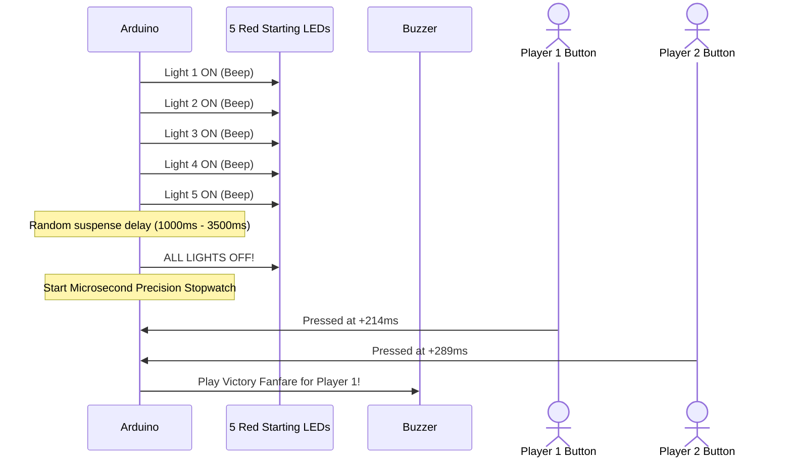

# Project 08: Formula 1 Reaction Speed Tester

**Track:** Foundational Arduino & Basic Electronics  
**Difficulty Level:** Beginner to Intermediate (Grades 6–9)  
**Estimated Time:** 45–60 Minutes  
**Target Group:** 2–4 Students (Great for club tournaments!)  

---

## 1. Project Overview
In Formula 1 motorsport, driver reaction times to starting lights are measured in thousandths of a second. In this project, students build a two-player reflex competition system. Five red LEDs illuminate one by one, accompanied by warning beeps. After a random suspense delay, all five lights simultaneously extinguish ("LIGHTS OUT AND AWAY WE GO!"). Players must hit their push buttons instantly. The Arduino measures reaction times down to the single millisecond and declares the winner on the Serial Monitor or buzzer!



---

## 2. Learning Objectives (STEM Concepts)
- **Human Biology & Neuroscience:** Neural pathways, visual stimulus processing speed, neuromuscular reaction delays (typical human reaction is 200–250ms).
- **Computer Science:** Real-time timing functions (`millis()` and `micros()`), pseudorandom number generators (`random()`), false-start jump detection.
- **Electronics:** Multi-LED array multiplexing and debounce filtering.

---

## 3. Bill of Materials
| Item | Quantity | Source / Link |
| :--- | :---: | :--- |
| Arduino Compatible Uno R3 | 1 | [Duino.lk Uno R3](https://www.duino.lk/product/arduino-compatible-r3-atmega328p-ch340g/) |
| Breadboard 830 Tie Point | 1 | [Duino.lk Breadboard 830](https://www.duino.lk/product/breadboard-830-tie-point-16-5x5-5x0-85-cm/) |
| 5mm Red LEDs | 5 | [Duino.lk LEDs](https://www.duino.lk/product/1000pcs-3mm-red-water-clear-led-1-9-2-1vdc-packet/) |
| 220Ω Resistors | 5 | [Duino.lk Resistors](https://www.duino.lk/product/2k-ohm-1-4w-smd-resistor-1206/) |
| 10kΩ Resistors | 2 | [Duino.lk Resistors](https://www.duino.lk/product/2k-ohm-1-4w-smd-resistor-1206/) |
| Tactile Push Buttons 12x12mm | 2 | [Duino.lk Push Button](https://www.duino.lk/product/tactile-push-button-switch-4pins-12x12x7-3mm/) |
| Piezo Electronic Buzzer | 1 | [Duino.lk Buzzer](https://www.duino.lk/product/dc-3-24v-electronic-buzzer/) |
| Jumper Wires Male-to-Male | 14 | [Duino.lk Jumper Wires](https://www.duino.lk/product/jumper-wire-male-to-male-20cm-40pcs/) |

---

## 4. Hardware Wiring & Pinout Table

| Component | Pin Connected To | Rationale |
| :--- | :--- | :--- |
| **LEDs 1 to 5 (Anodes)** | Arduino Pins **D3, D4, D5, D6, D7** | Five individual starting lights |
| **All LED Cathodes** | Ground rail via 220Ω resistors | Current limiting |
| **Player 1 Button** | Arduino **D2** (with 10kΩ pull-down to GND) | Player 1 trigger |
| **Player 2 Button** | Arduino **D8** (with 10kΩ pull-down to GND) | Player 2 trigger |
| **Piezo Buzzer (+)** | Arduino **D9** | Race start tone |

---

## 5. Arduino C++ Source Code

```cpp
/*
 * Project 08: Formula 1 Reaction Speed Tester
 * Club: School Electronics & Innovation Club
 */

const int LED_PINS[5] = {3, 4, 5, 6, 7};
const int PIN_BTN_P1  = 2;
const int PIN_BTN_P2  = 8;
const int PIN_BUZZER  = 9;

void setup() {
  for (int i = 0; i < 5; i++) {
    pinMode(LED_PINS[i], OUTPUT);
  }
  pinMode(PIN_BTN_P1, INPUT);
  pinMode(PIN_BTN_P2, INPUT);
  pinMode(PIN_BUZZER, OUTPUT);

  Serial.begin(9600);
  randomSeed(analogRead(A5)); // Random seed from unused floating pin
  Serial.println("=== F1 REACTION TESTER READY ===");
  Serial.println("Press any button to start race sequence...");
}

void loop() {
  // Wait for either player to trigger start
  while (digitalRead(PIN_BTN_P1) == LOW && digitalRead(PIN_BTN_P2) == LOW) {
    delay(10);
  }
  delay(1000); // Breathe before race starts

  Serial.println("
Starting grid sequence...");
  // Light up the 5 red lights sequentially
  for (int i = 0; i < 5; i++) {
    digitalWrite(LED_PINS[i], HIGH);
    tone(PIN_BUZZER, 440, 100);
    delay(1000);
  }

  // Random delay between 1.0 and 3.5 seconds
  int suspenseDelay = random(1000, 3500);
  unsigned long startWait = millis();
  bool falseStart = false;

  // Check for false starts (jump starts) during suspense period
  while (millis() - startWait < suspenseDelay) {
    if (digitalRead(PIN_BTN_P1) == HIGH) {
      Serial.println("PENALTY! Player 1 False Start (Jump Start)!");
      falseStart = true;
      break;
    }
    if (digitalRead(PIN_BTN_P2) == HIGH) {
      Serial.println("PENALTY! Player 2 False Start (Jump Start)!");
      falseStart = true;
      break;
    }
  }

  if (falseStart) {
    tone(PIN_BUZZER, 150, 800);
    for (int i = 0; i < 5; i++) digitalWrite(LED_PINS[i], LOW);
    delay(2000);
    return;
  }

  // LIGHTS OUT!
  for (int i = 0; i < 5; i++) {
    digitalWrite(LED_PINS[i], LOW);
  }
  tone(PIN_BUZZER, 880, 200); // High pitch GO tone!
  unsigned long raceStartTime = millis();

  // Wait for winner reaction
  unsigned long p1Time = 0;
  unsigned long p2Time = 0;

  while (p1Time == 0 || p2Time == 0) {
    if (p1Time == 0 && digitalRead(PIN_BTN_P1) == HIGH) {
      p1Time = millis() - raceStartTime;
    }
    if (p2Time == 0 && digitalRead(PIN_BTN_P2) == HIGH) {
      p2Time = millis() - raceStartTime;
    }
    // Timeout after 3 seconds if nobody clicks
    if (millis() - raceStartTime > 3000) break;
  }

  Serial.println(">>> RESULTS <<<");
  Serial.print("Player 1 Reaction: "); Serial.print(p1Time); Serial.println(" ms");
  Serial.print("Player 2 Reaction: "); Serial.print(p2Time); Serial.println(" ms");

  if (p1Time > 0 && (p1Time < p2Time || p2Time == 0)) {
    Serial.println("🏆 PLAYER 1 WINS!");
    tone(PIN_BUZZER, 1046, 500);
  } else if (p2Time > 0 && (p2Time < p1Time || p1Time == 0)) {
    Serial.println("🏆 PLAYER 2 WINS!");
    tone(PIN_BUZZER, 1318, 500);
  }

  delay(3000); // Cooldown before next race
}
```

---

## 7. Innovation Challenges
1. Combine with the [16x2 LCD](https://www.duino.lk/product/lcd-16x02-display-blue/) to make the machine totally portable for school exhibition game booths!
2. Track the "All-Time Club Record" saved in Arduino internal EEPROM non-volatile memory so records persist even after unplugging power.
