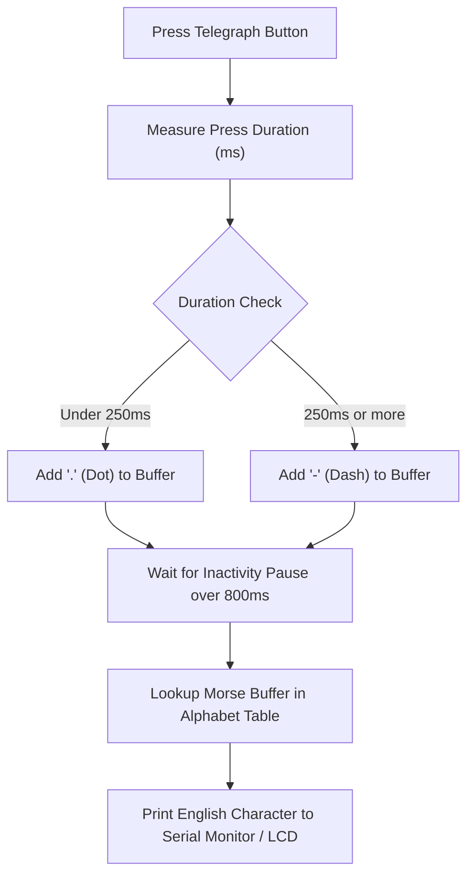

# Project 09: Audio-Visual Morse Code Keyer & Decoder

**Track:** Foundational Arduino & Basic Electronics  
**Difficulty Level:** Intermediate (Grades 7–10)  
**Estimated Time:** 60 Minutes  
**Target Group:** 2 Students  

---

## 1. Project Overview
Invented in the 1830s by Samuel Morse, Morse code remains the cornerstone of telecommunications history. In this project, students build a telegraph station with an Arduino Nano, a tactile keying button, an LED indicator, and a piezo buzzer. As the student presses the key, the system plays audio sidetones and computes the exact duration of each press: short presses are registered as "Dots" (dits) and longer presses as "Dashes" (dahs). The Arduino decodes the sequence in real time and prints out the English alphabet letter!



---

## 2. Learning Objectives (STEM Concepts)
- **Telecommunications History:** Binary encoding, variable-length codes, information theory (why frequent letters like 'E' and 'T' have short codes).
- **String Algorithms:** Buffer accumulation, pattern matching, lookup tables (LUT).
- **Electronics:** Passive audio generation, switch debounce handling.

---

## 3. Bill of Materials
| Item | Quantity | Source / Link |
| :--- | :---: | :--- |
| Arduino Compatible Nano V3.0 | 1 | [Duino.lk Nano V3.0](https://www.duino.lk/product/arduino-compatible-nano-v3-0/) |
| Breadboard 830 Tie Point | 1 | [Duino.lk Breadboard 830](https://www.duino.lk/product/breadboard-830-tie-point-16-5x5-5x0-85-cm/) |
| Tactile Push Button 12x12mm | 1 | [Duino.lk Push Button](https://www.duino.lk/product/tactile-push-button-switch-4pins-12x12x7-3mm/) |
| 10kΩ Resistor (Pull-down) | 1 | [Duino.lk Resistors](https://www.duino.lk/product/2k-ohm-1-4w-smd-resistor-1206/) |
| 5mm Yellow or Red LED | 1 | [Duino.lk LEDs](https://www.duino.lk/product/1000pcs-3mm-red-water-clear-led-1-9-2-1vdc-packet/) |
| 220Ω Resistor | 1 | [Duino.lk Resistors](https://www.duino.lk/product/2k-ohm-1-4w-smd-resistor-1206/) |
| Piezo Electronic Buzzer | 1 | [Duino.lk Buzzer](https://www.duino.lk/product/dc-3-24v-electronic-buzzer/) |
| Jumper Wires Male-to-Male | 8 | [Duino.lk Jumper Wires](https://www.duino.lk/product/jumper-wire-male-to-male-20cm-40pcs/) |

---

## 4. Hardware Wiring Table

| Component Pin | Arduino Nano Pin | Notes |
| :--- | :--- | :--- |
| **Telegraph Key (Button)** | Pin **D2** (with 10kΩ to GND) | Other button terminal connects to +5V |
| **Indicator LED (+)** | Pin **D13** via 220Ω resistor | Visual feedback during transmission |
| **Piezo Buzzer (+)** | Pin **D8** | Emits 750Hz telegraph audio sidetone |
| **Ground Returns** | Breadboard GND rail | Connected to Arduino GND |

---

## 5. Arduino C++ Source Code

```cpp
/*
 * Project 09: Audio-Visual Morse Code Keyer & Decoder
 * Club: School Electronics & Innovation Club
 */

const int PIN_KEY    = 2;
const int PIN_BUZZER = 8;
const int PIN_LED    = 13;

const int DOT_THRESHOLD = 250;   // Less than 250ms = DOT; greater = DASH
const int LETTER_PAUSE  = 800;   // 800ms of silence indicates letter complete

unsigned long pressStartTime = 0;
unsigned long releaseStartTime = 0;
bool isPressed = false;
String morseBuffer = "";

// Lookup table for Morse code letters A-Z
const char* morseTable[26] = {
  ".-", "-...", "-.-.", "-..", ".", "..-.", "--.", "....", "..",   // A-I
  ".---", "-.-", ".-..", "--", "-.", "---", ".--.", "--.-", ".-.", // J-R
  "...", "-", "..-", "...-", ".--", "-..-", "-.--", "--.."        // S-Z
};

char decodeMorse(String code) {
  for (int i = 0; i < 26; i++) {
    if (code == morseTable[i]) {
      return (char)('A' + i);
    }
  }
  if (code == "...---...") return '!'; // SOS!
  return '?'; // Unknown code
}

void setup() {
  pinMode(PIN_KEY, INPUT);
  pinMode(PIN_BUZZER, OUTPUT);
  pinMode(PIN_LED, OUTPUT);

  Serial.begin(9600);
  Serial.println("=== MORSE CODE TELEGRAPH STATION INITIALIZED ===");
  Serial.println("Tap button to send: Short = Dot (.), Long = Dash (-)");
}

void loop() {
  int buttonState = digitalRead(PIN_KEY);

  // Key Down (Press)
  if (buttonState == HIGH && !isPressed) {
    isPressed = true;
    pressStartTime = millis();
    digitalWrite(PIN_LED, HIGH);
    tone(PIN_BUZZER, 750); // Play telegraph tone
  }
  // Key Up (Release)
  else if (buttonState == LOW && isPressed) {
    isPressed = false;
    unsigned long pressDuration = millis() - pressStartTime;
    noTone(PIN_BUZZER);
    digitalWrite(PIN_LED, LOW);
    releaseStartTime = millis();

    if (pressDuration > 40) { // Debounce threshold
      if (pressDuration < DOT_THRESHOLD) {
        morseBuffer += ".";
        Serial.print(".");
      } else {
        morseBuffer += "-";
        Serial.print("-");
      }
    }
  }

  // Check if letter pause threshold has been exceeded while idle
  if (!isPressed && morseBuffer.length() > 0) {
    if (millis() - releaseStartTime > LETTER_PAUSE) {
      char decodedLetter = decodeMorse(morseBuffer);
      Serial.print(" -> ");
      Serial.println(decodedLetter);
      morseBuffer = ""; // Reset buffer for next letter
    }
  }
}
```

---

## 6. Testing & Famous Practice Words
- Try typing **SOS** (`...` pause `---` pause `...`):
  1. Three quick taps (`...`) -> Board prints **S**
  2. Three long presses (`---`) -> Board prints **O**
  3. Three quick taps (`...`) -> Board prints **S**
- Try typing **HELLO**:
  - `....` -> **H**
  - `.` -> **E**
  - `.-..` -> **L**
  - `.-..` -> **L**
  - `---` -> **O**

---

## 7. Innovation Challenges
1. **Reverse Mode (Text to Morse):** Type an English word into the Arduino Serial Monitor input box and have the Arduino automatically beep out the correct Morse audio rhythm!
