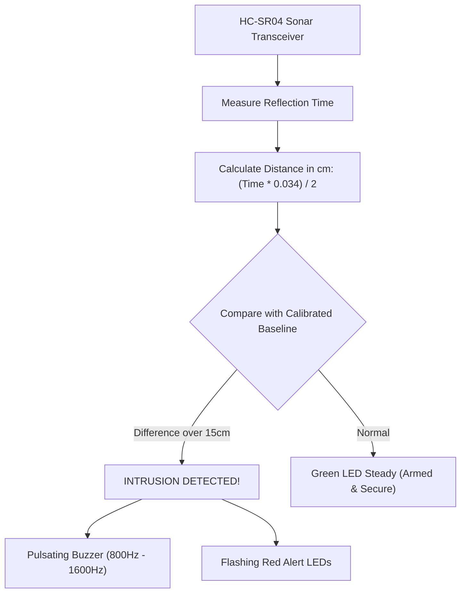

# Project 10: Ultrasonic Tripwire Security Alarm

**Track:** Foundational Arduino & Basic Electronics  
**Difficulty Level:** Intermediate (Grades 7–10)  
**Estimated Time:** 60 Minutes  
**Target Group:** 2 Students  

---

## 1. Project Overview
Traditional security tripwires use fragile laser beams that are easily bypassed. In this project, students build an invisible ultrasonic acoustic barrier using the HC-SR04 sensor and an Arduino Nano. Mounted across a doorway or safe box, the sensor continuously monitors spatial distance. The moment an intruder walks across the threshold, the distance reading abruptly changes, triggering a loud pulsating alarm siren and strobe lighting!



---

## 2. Learning Objectives (STEM Concepts)
- **Acoustic Physics:** Speed of sound in air (343 m/s at 20°C), ultrasonic frequencies (40 kHz, beyond human hearing), echo reflection.
- **Microsecond Timing:** Calculating distance via time-of-flight equations ($d = rac{v 	imes t}{2}$).
- **Security Systems Design:** Automatic baseline auto-calibration upon power-up, tamper detection.

---

## 3. Bill of Materials
| Item | Quantity | Source / Link |
| :--- | :---: | :--- |
| Arduino Compatible Nano V3.0 | 1 | [Duino.lk Nano V3.0](https://www.duino.lk/product/arduino-compatible-nano-v3-0/) |
| HC-SR04 Ultrasonic Distance Sensor | 1 | [Duino.lk HC-SR04](https://www.duino.lk/product/ultrasonic-distance-measuring-transducer/) |
| Breadboard 830 Tie Point | 1 | [Duino.lk Breadboard 830](https://www.duino.lk/product/breadboard-830-tie-point-16-5x5-5x0-85-cm/) |
| 5mm Red LED (Alarm Strobe) | 1 | [Duino.lk LEDs](https://www.duino.lk/product/1000pcs-3mm-red-water-clear-led-1-9-2-1vdc-packet/) |
| 5mm Green LED (Armed Indicator) | 1 | [Duino.lk LEDs](https://www.duino.lk/product/1000pcs-3mm-red-water-clear-led-1-9-2-1vdc-packet/) |
| 220Ω Resistors | 2 | [Duino.lk Resistors](https://www.duino.lk/product/2k-ohm-1-4w-smd-resistor-1206/) |
| Piezo Electronic Buzzer | 1 | [Duino.lk Buzzer](https://www.duino.lk/product/dc-3-24v-electronic-buzzer/) |
| Jumper Wires Male-to-Female | 4 | [Duino.lk Jumper Wires](https://www.duino.lk/product/jumper-wire-male-to-female-20cm-40pcs/) |
| Jumper Wires Male-to-Male | 6 | [Duino.lk Jumper Wires](https://www.duino.lk/product/jumper-wire-male-to-male-20cm-40pcs/) |

---

## 4. Hardware Wiring & Pinout Table

| HC-SR04 Sensor Pin | Arduino Nano Pin | Purpose |
| :--- | :--- | :--- |
| **VCC** | 5V | Sensor power (+5V DC) |
| **GND** | GND | Ground |
| **TRIG** | Pin **D9** | 10-microsecond trigger pulse output |
| **ECHO** | Pin **D10** | Echo return pulse input |

| Other Components | Connection |
| :--- | :--- |
| **Green LED Anode** | Pin **D4** via 220Ω resistor (Armed Status) |
| **Red LED Anode** | Pin **D5** via 220Ω resistor (Alarm Strobe) |
| **Piezo Buzzer (+)** | Pin **D6** |

---

## 5. Arduino C++ Source Code

```cpp
/*
 * Project 10: Ultrasonic Tripwire Security Alarm
 * Club: School Electronics & Innovation Club
 */

const int PIN_TRIG    = 9;
const int PIN_ECHO    = 10;
const int PIN_LED_ARM = 4;
const int PIN_LED_ALM = 5;
const int PIN_BUZZER  = 6;

float baselineDistance = 0.0;
bool alarmTriggered = false;

float measureDistanceCM() {
  // Clear trigger pin
  digitalWrite(PIN_TRIG, LOW);
  delayMicroseconds(2);
  
  // Send 10us ultrasonic burst
  digitalWrite(PIN_TRIG, HIGH);
  delayMicroseconds(10);
  digitalWrite(PIN_TRIG, LOW);
  
  // Read echo bounce back duration in microseconds
  long duration = pulseIn(PIN_ECHO, HIGH, 30000); // 30ms timeout
  if (duration == 0) return 999.0; // Out of range
  
  // Distance in cm = (duration * 0.0343) / 2
  return (duration * 0.0343) / 2.0;
}

void setup() {
  pinMode(PIN_TRIG, OUTPUT);
  pinMode(PIN_ECHO, INPUT);
  pinMode(PIN_LED_ARM, OUTPUT);
  pinMode(PIN_LED_ALM, OUTPUT);
  pinMode(PIN_BUZZER, OUTPUT);

  Serial.begin(9600);
  Serial.println("Calibrating security perimeter in 3 seconds...");
  
  // Beep warning during calibration
  for (int i = 0; i < 3; i++) {
    digitalWrite(PIN_LED_ARM, HIGH);
    tone(PIN_BUZZER, 800, 100);
    delay(500);
    digitalWrite(PIN_LED_ARM, LOW);
    delay(500);
  }

  // Calculate average baseline distance over 10 samples
  float sum = 0;
  for (int i = 0; i < 10; i++) {
    sum += measureDistanceCM();
    delay(50);
  }
  baselineDistance = sum / 10.0;
  
  digitalWrite(PIN_LED_ARM, HIGH); // Steady green = ARMED
  Serial.print("System Armed! Baseline Distance: ");
  Serial.print(baselineDistance);
  Serial.println(" cm");
}

void loop() {
  float currentDist = measureDistanceCM();

  // If distance changes by more than 20cm (intruder enters beam)
  if (abs(currentDist - baselineDistance) > 20.0 && currentDist < baselineDistance) {
    alarmTriggered = true;
    Serial.println("🚨 INTRUSION DETECTED! Perimeter Breached!");
  }

  if (alarmTriggered) {
    digitalWrite(PIN_LED_ARM, LOW);
    // Two-tone European Police Siren
    for (int freq = 800; freq <= 1500; freq += 40) {
      tone(PIN_BUZZER, freq);
      digitalWrite(PIN_LED_ALM, HIGH);
      delay(15);
    }
    digitalWrite(PIN_LED_ALM, LOW);
    for (int freq = 1500; freq >= 800; freq -= 40) {
      tone(PIN_BUZZER, freq);
      delay(15);
    }
  } else {
    delay(80); // Normal surveillance sample rate
  }
}
```

---

## 6. Innovation Challenges
1. **Passcode Deactivation:** Add a tactile push button so the owner can enter a secret "click pattern" (e.g., Short-Short-Long) to disarm the alarm without having to unplug it!
2. **Relay Floodlight:** Connect the alarm output to the club's [5V Relay Module](https://www.duino.lk/product/relay-board-module-5v-1-channel/) to automatically switch on a blinding security spotlight!
