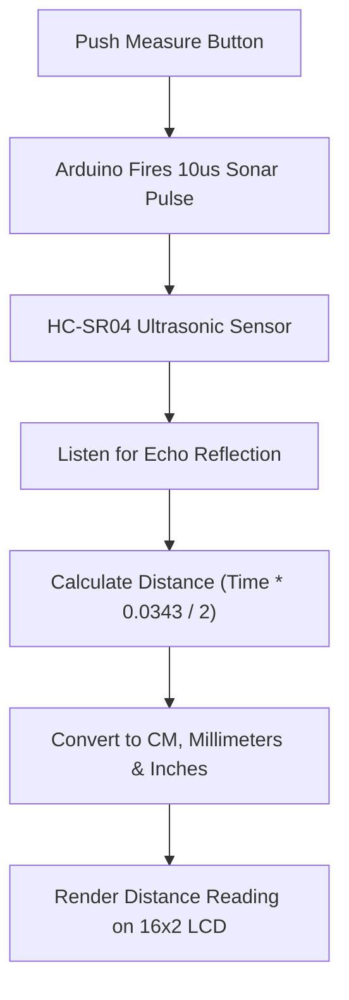

# Project 12: Ultrasonic Digital Measuring Tape with LCD

**Track:** Sensor Measurement & Display Systems  
**Difficulty Level:** Intermediate (Grades 7–10)  
**Estimated Time:** 60 Minutes  
**Target Group:** 2 Students  

---

## 1. Project Overview
Tape measures can be cumbersome when measuring high ceilings or wide classroom walls. In this project, students build an acoustic "electronic measuring tape" featuring the HC-SR04 sonar module, an Arduino Uno, a push button, and an I2C LCD display. Pressing the measurement button fires a burst of sound waves, calculates the precise distance in centimeters, inches, and millimeters, and freezes the reading on screen.



---

## 2. Learning Objectives (STEM Concepts)
- **Physics of Sound:** Acoustic waves, air density effects, ultrasonic beam dispersion angles (15-degree cone).
- **Unit Conversions:** Mathematical transformations ($1 	ext{ inch} = 2.54 	ext{ cm}$, $1 	ext{ cm} = 10 	ext{ mm}$).
- **Precision Engineering:** Statistical averaging (taking median of multiple pulses to eliminate spurious acoustic outliers).

---

## 3. Bill of Materials
| Item | Quantity | Source / Link |
| :--- | :---: | :--- |
| Arduino Compatible Uno R3 | 1 | [Duino.lk Uno R3](https://www.duino.lk/product/arduino-compatible-r3-atmega328p-ch340g/) |
| HC-SR04 Ultrasonic Distance Sensor | 1 | [Duino.lk HC-SR04](https://www.duino.lk/product/ultrasonic-distance-measuring-transducer/) |
| LCD 16x2 Character Display + I2C Adapter | 1 | [Duino.lk LCD 16x2](https://www.duino.lk/product/lcd-16x02-display-blue/) |
| Tactile Push Button 12x12mm | 1 | [Duino.lk Push Button](https://www.duino.lk/product/tactile-push-button-switch-4pins-12x12x7-3mm/) |
| 10kΩ Resistor (Pull-down) | 1 | [Duino.lk Resistors](https://www.duino.lk/product/2k-ohm-1-4w-smd-resistor-1206/) |
| 9V Battery Snap Connector Clip | 1 | [Duino.lk 9V Snap](https://www.duino.lk/product/9v-battery-snap-on-connector-clip/) |
| Breadboard 830 Tie Point | 1 | [Duino.lk Breadboard 830](https://www.duino.lk/product/breadboard-830-tie-point-16-5x5-5x0-85-cm/) |

---

## 4. Hardware Wiring Table

| Component Pin | Arduino Uno Pin | Notes |
| :--- | :--- | :--- |
| **HC-SR04 VCC / GND** | 5V / GND | Sensor power |
| **HC-SR04 TRIG** | Pin **D9** | Trigger signal |
| **HC-SR04 ECHO** | Pin **D10** | Echo return signal |
| **Measure Button** | Pin **D2** (with 10kΩ to GND) | Active HIGH measurement trigger |
| **LCD I2C SDA** | Pin **A4** | Serial Data |
| **LCD I2C SCL** | Pin **A5** | Serial Clock |

---

## 5. Arduino C++ Source Code

```cpp
/*
 * Project 12: Ultrasonic Digital Measuring Tape with LCD
 * Club: School Electronics & Innovation Club
 */

#include <Wire.h>
#include <LiquidCrystal_I2C.h>

const int PIN_TRIG = 9;
const int PIN_ECHO = 10;
const int PIN_BTN  = 2;

LiquidCrystal_I2C lcd(0x27, 16, 2);

float getAccurateDistance() {
  float readings[5];
  for (int i = 0; i < 5; i++) {
    digitalWrite(PIN_TRIG, LOW);
    delayMicroseconds(2);
    digitalWrite(PIN_TRIG, HIGH);
    delayMicroseconds(10);
    digitalWrite(PIN_TRIG, LOW);

    long duration = pulseIn(PIN_ECHO, HIGH, 35000);
    if (duration == 0) readings[i] = 400.0;
    else readings[i] = (duration * 0.0343) / 2.0;
    delay(20);
  }
  // Simple average of 5 burst readings
  float sum = 0;
  for (int i = 0; i < 5; i++) sum += readings[i];
  return sum / 5.0;
}

void setup() {
  pinMode(PIN_TRIG, OUTPUT);
  pinMode(PIN_ECHO, INPUT);
  pinMode(PIN_BTN, INPUT);

  lcd.init();
  lcd.backlight();
  lcd.setCursor(0, 0);
  lcd.print("SONAR TAPE METER");
  lcd.setCursor(0, 1);
  lcd.print("Press To Measure");
}

void loop() {
  if (digitalRead(PIN_BTN) == HIGH) {
    lcd.clear();
    lcd.setCursor(0, 0);
    lcd.print("Measuring...");
    delay(200);

    float distCm = getAccurateDistance();
    float distInches = distCm / 2.54;

    lcd.clear();
    lcd.setCursor(0, 0);
    lcd.print("Dist: ");
    lcd.print(distCm, 1);
    lcd.print(" cm");

    lcd.setCursor(0, 1);
    lcd.print("      ");
    lcd.print(distInches, 1);
    lcd.print(" in");

    delay(800); // Debounce delay
  }
}
```

---

## 6. Testing & Calibration
1. Align the front face of the HC-SR04 flush against a standard wooden meter rule on a desk.
2. Place a flat book perpendicular to the beam at exactly 30.0 cm.
3. Hit the button: verify that the LCD shows `30.0 cm` (±0.5 cm).
4. Power with a 9V battery to turn it into an untethered, handheld tape measure!

---

## 7. Innovation Challenges
1. **Area & Volume Calculator:** Store Length, Width, and Height with 3 button taps, and automatically display Room Floor Area ($m^2$) and Volume ($m^3$)!
