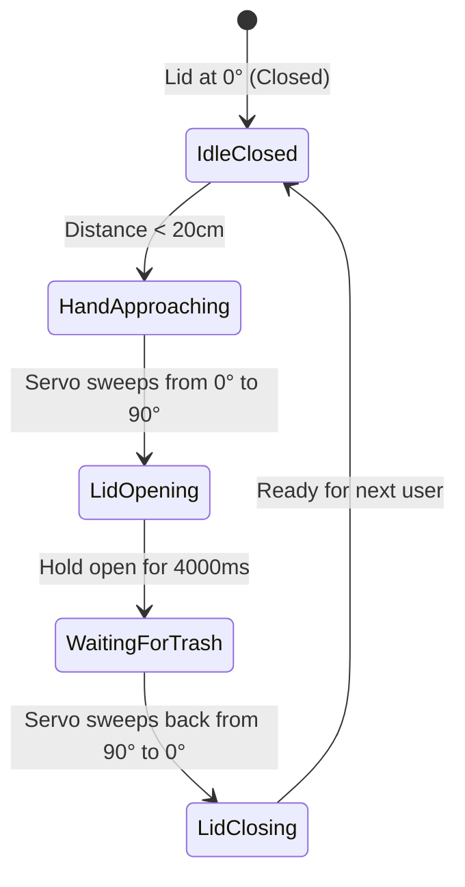

# Project 13: Touchless Smart Dustbin with Servo Lid

**Track:** Sensor Measurement & Physical Mechatronics  
**Difficulty Level:** Intermediate (Grades 7–10)  
**Estimated Time:** 75 Minutes  
**Target Group:** 2–3 Students  

---

## 1. Project Overview
Hygiene in school laboratories and medical facilities requires minimizing physical contact with waste bins. In this popular innovation project, students build an automatic, touchless smart trash can. An ultrasonic sensor detects an approaching hand within 20cm, commanding an SG90 micro-servo motor to smoothly pivot the lid open to 90 degrees, hold it open for 4 seconds, and gently close it automatically!



---

## 2. Learning Objectives (STEM Concepts)
- **Public Health Tech:** Automated sanitary containment, preventing viral cross-contamination.
- **Mechanical Leverage:** Fulcrum and torque calculations, linkage geometry for hinged lids.
- **Embedded State Transitions:** State machines, timed transitions, preventing servo motor jitter.

---

## 3. Bill of Materials
| Item | Quantity | Source / Link |
| :--- | :---: | :--- |
| Arduino Compatible Nano V3.0 | 1 | [Duino.lk Nano V3.0](https://www.duino.lk/product/arduino-compatible-nano-v3-0/) |
| HC-SR04 Ultrasonic Distance Sensor | 1 | [Duino.lk HC-SR04](https://www.duino.lk/product/ultrasonic-distance-measuring-transducer/) |
| SG90 9g Micro Servo Motor | 1 | [Duino.lk SG90 Servo](https://www.duino.lk/product/servo-motor-sg90-9g/) |
| 60W Hot Melt Glue Gun + Glue Sticks | 1 | [Duino.lk Glue Gun](https://www.duino.lk/product/60w-glue-gun-nozzle-sd-a6/) |
| Breadboard Mini 170 Tie-points | 1 | [Duino.lk Mini Breadboard](https://www.duino.lk/product/breadboard-mini-170-tie-points/) |
| Cardboard Box with hinged lid | 1 | Recycled Club Materials |
| 9V Battery Snap Connector | 1 | [Duino.lk 9V Snap](https://www.duino.lk/product/9v-battery-snap-on-connector-clip/) |

---

## 4. Hardware Wiring & Pinout Table

| Component Pin | Arduino Nano Pin | Notes |
| :--- | :--- | :--- |
| **HC-SR04 TRIG** | Pin **D9** | Trigger pulse output |
| **HC-SR04 ECHO** | Pin **D10** | Echo return pulse input |
| **Servo Orange (PWM)** | Pin **D5** | 50Hz Servo control signal |
| **Servo Red (VCC)** | 5V | Power |
| **Servo Brown (GND)** | GND | Ground |

---

## 5. Arduino C++ Source Code

```cpp
/*
 * Project 13: Touchless Smart Dustbin with Servo Lid
 * Club: School Electronics & Innovation Club
 */

#include <Servo.h>

const int PIN_TRIG  = 9;
const int PIN_ECHO  = 10;
const int PIN_SERVO = 5;

const int TRIGGER_DISTANCE = 20; // Open lid when hand is closer than 20cm
const int OPEN_ANGLE  = 95;      // Lid fully open position
const int CLOSED_ANGLE = 5;      // Lid fully closed position

Servo lidServo;

float readDistance() {
  digitalWrite(PIN_TRIG, LOW);
  delayMicroseconds(2);
  digitalWrite(PIN_TRIG, HIGH);
  delayMicroseconds(10);
  digitalWrite(PIN_TRIG, LOW);

  long duration = pulseIn(PIN_ECHO, HIGH, 25000);
  if (duration == 0) return 999.0;
  return (duration * 0.0343) / 2.0;
}

void setup() {
  pinMode(PIN_TRIG, OUTPUT);
  pinMode(PIN_ECHO, INPUT);

  lidServo.attach(PIN_SERVO);
  lidServo.write(CLOSED_ANGLE); // Start in closed position
  delay(500);

  Serial.begin(9600);
  Serial.println("Smart Dustbin Initialized.");
}

void loop() {
  float distance = readDistance();
  Serial.print("Hand Distance: "); Serial.println(distance);

  if (distance > 2 && distance < TRIGGER_DISTANCE) {
    Serial.println("Hand detected! Opening lid...");
    // Smooth servo opening
    for (int pos = CLOSED_ANGLE; pos <= OPEN_ANGLE; pos += 3) {
      lidServo.write(pos);
      delay(15);
    }

    // Keep lid open for 4 seconds to drop trash
    delay(4000);

    Serial.println("Closing lid...");
    // Smooth gentle closing
    for (int pos = OPEN_ANGLE; pos >= CLOSED_ANGLE; pos -= 3) {
      lidServo.write(pos);
      delay(15);
    }
    delay(500); // Rest before allowing another trigger
  }

  delay(100);
}
```

---

## 6. Physical Fabrication with Hot Melt Glue
1. Cut out two circular eye holes on the front lid of a small cardboard box for the HC-SR04 sonar transducers.
2. Secure the HC-SR04 with hot glue on the interior face pointing outwards.
3. Glue the SG90 servo motor firmly inside the rear corner of the box wall.
4. Hot-glue a popsicle stick or stiff wire link between the servo horn and the box lid to act as a mechanical lifting lever.
5. Power up and test by waving your hand in front of the ultrasonic "eyes"!

---

## 7. Innovation Challenges
1. **Trash Full Warning:** Mount a second HC-SR04 pointing downward inside the bin to alert `"BIN FULL! PLEASE EMPTY"` via a buzzer when trash fills up past 80%!
