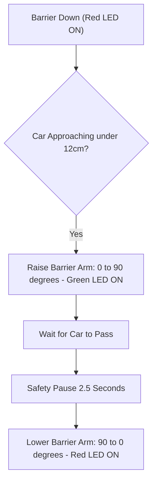

# Project 14: Smart Car Park Barrier Gate with Sonar & Indicator Lights

**Track:** Sensor Measurement & Physical Mechatronics  
**Difficulty Level:** Intermediate (Grades 7–10)  
**Estimated Time:** 60 Minutes  
**Target Group:** 2 Students  

---

## 1. Project Overview
Automated toll gates and smart parking garages manage vehicle ingress using ultrasonic detection and motorized barrier arms. In this project, students construct a working scale model of an automated boom barrier. When an approaching vehicle car stops in front of the gate, an ultrasonic sensor detects presence, changes the overhead signal light from Red to Green, raises the barrier arm using an SG90 servo motor, waits for the car to drive through, and lowers the arm securely.



---

## 2. Learning Objectives (STEM Concepts)
- **Transportation Engineering:** Traffic flow management, tolling systems, fail-safe barrier interlocks.
- **Mechatronics:** Rotary-to-linear kinematic motion, servo horn alignment.
- **Software State Machines:** Entry, transit, and exit verification cycles.

---

## 3. Bill of Materials
| Item | Quantity | Source / Link |
| :--- | :---: | :--- |
| Arduino Compatible Uno R3 | 1 | [Duino.lk Uno R3](https://www.duino.lk/product/arduino-compatible-r3-atmega328p-ch340g/) |
| HC-SR04 Ultrasonic Distance Sensor | 1 | [Duino.lk HC-SR04](https://www.duino.lk/product/ultrasonic-distance-measuring-transducer/) |
| SG90 9g Micro Servo Motor | 1 | [Duino.lk SG90 Servo](https://www.duino.lk/product/servo-motor-sg90-9g/) |
| 5mm Red LED & 5mm Green LED | 2 | [Duino.lk LEDs](https://www.duino.lk/product/1000pcs-3mm-red-water-clear-led-1-9-2-1vdc-packet/) |
| 220Ω Resistors | 2 | [Duino.lk Resistors](https://www.duino.lk/product/2k-ohm-1-4w-smd-resistor-1206/) |
| 60W Hot Melt Glue Gun & Popsicle stick (Gate arm) | 1 | [Duino.lk Glue Gun](https://www.duino.lk/product/60w-glue-gun-nozzle-sd-a6/) |
| Breadboard 830 Tie Point | 1 | [Duino.lk Breadboard 830](https://www.duino.lk/product/breadboard-830-tie-point-16-5x5-5x0-85-cm/) |

---

## 4. Hardware Wiring Table

| Component Pin | Arduino Uno Pin | Purpose |
| :--- | :--- | :--- |
| **HC-SR04 TRIG** | Pin **D9** | Sonar pulse trigger |
| **HC-SR04 ECHO** | Pin **D10** | Sonar pulse echo |
| **SG90 Servo PWM** | Pin **D6** | 50Hz barrier arm position control |
| **Red LED Anode** | Pin **D4** via 220Ω | STOP signal light |
| **Green LED Anode** | Pin **D5** via 220Ω | GO signal light |

---

## 5. Arduino C++ Source Code

```cpp
/*
 * Project 14: Smart Car Park Barrier Gate
 * Club: School Electronics & Innovation Club
 */

#include <Servo.h>

const int PIN_TRIG      = 9;
const int PIN_ECHO      = 10;
const int PIN_SERVO     = 6;
const int PIN_LED_RED   = 4;
const int PIN_LED_GREEN = 5;

const int GATE_CLOSED = 0;  // Horizontal barrier arm
const int GATE_OPEN   = 90; // Vertical barrier arm

Servo barrierServo;

float checkDistance() {
  digitalWrite(PIN_TRIG, LOW);
  delayMicroseconds(2);
  digitalWrite(PIN_TRIG, HIGH);
  delayMicroseconds(10);
  digitalWrite(PIN_TRIG, LOW);

  long duration = pulseIn(PIN_ECHO, HIGH, 25000);
  if (duration == 0) return 999.0;
  return (duration * 0.0343) / 2.0;
}

void setup() {
  pinMode(PIN_TRIG, OUTPUT);
  pinMode(PIN_ECHO, INPUT);
  pinMode(PIN_LED_RED, OUTPUT);
  pinMode(PIN_LED_GREEN, OUTPUT);

  barrierServo.attach(PIN_SERVO);
  barrierServo.write(GATE_CLOSED);
  digitalWrite(PIN_LED_RED, HIGH);
  digitalWrite(PIN_LED_GREEN, LOW);

  Serial.begin(9600);
  Serial.println("Barrier Gate Ready.");
}

void loop() {
  float distance = checkDistance();

  // If vehicle approaches within 12cm
  if (distance > 2 && distance < 12) {
    Serial.println("Vehicle approaching! Raising barrier...");
    digitalWrite(PIN_LED_RED, LOW);
    digitalWrite(PIN_LED_GREEN, HIGH);

    // Raise barrier arm
    barrierServo.write(GATE_OPEN);
    delay(2000); // Wait for vehicle to begin passing

    // Keep gate open while car is underneath
    while (checkDistance() < 15) {
      delay(200);
    }
    delay(1500); // Safety buffer to ensure tail clears

    // Lower barrier
    Serial.println("Vehicle cleared. Lowering barrier...");
    barrierServo.write(GATE_CLOSED);
    digitalWrite(PIN_LED_GREEN, LOW);
    digitalWrite(PIN_LED_RED, HIGH);
    delay(1000);
  }

  delay(100);
}
```

---

## 6. Innovation Challenges
1. Combine with the [16x2 I2C LCD](https://www.duino.lk/product/lcd-16x02-display-blue/) to display `"AVAILABLE SLOTS: 04"`, automatically counting down as cars enter!
