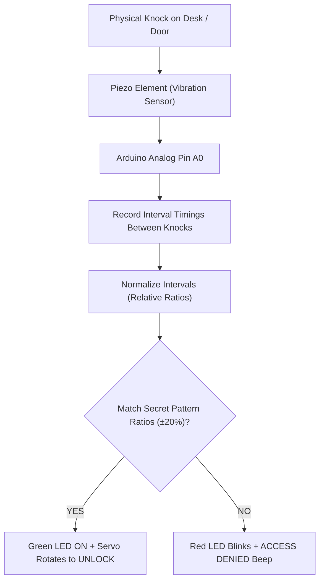

# Project 15: Acoustic Secret Knock Lock Detector

**Track:** Sensor Measurement & Physical Mechatronics  
**Difficulty Level:** Intermediate to Advanced (Grades 8–11)  
**Estimated Time:** 75 Minutes  
**Target Group:** 2 Students  

---

## 1. Project Overview
Piezoelectric elements are reversible transducers: when stimulated with an AC voltage, they emit sound; when physically deformed by mechanical vibration or sound waves, they generate a microvolt electrical potential. In this project, students use a piezo buzzer element in reverse as a seismic tap sensor. An Arduino listens for a rhythmic "secret knock" pattern (e.g., "Shave and a Haircut... Two Bits!"). If the knock intervals match the secret rhythm within a 20% tolerance, an SG90 servo motor rotates 90 degrees to mechanically unlock a safe box!



---

## 2. Learning Objectives (STEM Concepts)
- **Piezoelectricity:** Crystal lattice deformation generating electrostatic potential.
- **Signal Normalization:** Why timing ratios must be evaluated relatively rather than by absolute milliseconds (so a secret knock works whether knocked fast or slow).
- **Security Pattern Recognition:** Algorithmic verification, false rejection vs. false acceptance rates.

---

## 3. Bill of Materials
| Item | Quantity | Source / Link |
| :--- | :---: | :--- |
| Arduino Compatible Uno R3 | 1 | [Duino.lk Uno R3](https://www.duino.lk/product/arduino-compatible-r3-atmega328p-ch340g/) |
| Piezo Electronic Buzzer (Used as sensor) | 1 | [Duino.lk Buzzer](https://www.duino.lk/product/dc-3-24v-electronic-buzzer/) |
| 1MΩ Resistor (or 2x 10k in series for damping) | 1 | [Duino.lk Resistors](https://www.duino.lk/product/2k-ohm-1-4w-smd-resistor-1206/) |
| SG90 9g Micro Servo Motor | 1 | [Duino.lk SG90 Servo](https://www.duino.lk/product/servo-motor-sg90-9g/) |
| 5mm Green LED & 5mm Red LED | 2 | [Duino.lk LEDs](https://www.duino.lk/product/1000pcs-3mm-red-water-clear-led-1-9-2-1vdc-packet/) |
| 220Ω Resistors | 2 | [Duino.lk Resistors](https://www.duino.lk/product/2k-ohm-1-4w-smd-resistor-1206/) |
| Breadboard 830 Tie Point | 1 | [Duino.lk Breadboard 830](https://www.duino.lk/product/breadboard-830-tie-point-16-5x5-5x0-85-cm/) |

---

## 4. Hardware Wiring Table

| Component Pin | Arduino Uno Pin | Notes |
| :--- | :--- | :--- |
| **Piezo (+) Positive Lead** | Analog Pin **A0** | Connected across 10kΩ resistor to GND |
| **Piezo (-) Negative Lead** | GND | Ground |
| **SG90 Servo PWM** | Pin **D9** | Unlocks deadbolt latch |
| **Green LED Anode** | Pin **D4** via 220Ω | Unlock success indicator |
| **Red LED Anode** | Pin **D5** via 220Ω | Locked / reject indicator |

---

## 5. Arduino C++ Source Code

```cpp
/*
 * Project 15: Acoustic Secret Knock Lock Detector
 * Club: School Electronics & Innovation Club
 */

#include <Servo.h>

const int PIN_PIEZO    = A0;
const int PIN_SERVO    = 9;
const int PIN_LED_GRN  = 4;
const int PIN_LED_RED  = 5;

const int KNOCK_THRESHOLD = 80; // Sensitivity to knocks (0-1023)
const int SECRET_COUNT = 5;     // Number of knocks in secret pattern
// Relative interval ratios between knocks (normalized to first interval = 100)
// Pattern: Knock ... Knock . Knock . Knock ... Knock
const int SECRET_RATIOS[SECRET_COUNT - 1] = {100, 50, 50, 100};

int knockIntervals[SECRET_COUNT - 1];
int knockIndex = 0;
unsigned long lastKnockTime = 0;

Servo lockServo;

void setup() {
  pinMode(PIN_LED_GRN, OUTPUT);
  pinMode(PIN_LED_RED, OUTPUT);
  lockServo.attach(PIN_SERVO);
  lockServo.write(0); // Locked position
  digitalWrite(PIN_LED_RED, HIGH);

  Serial.begin(9600);
  Serial.println("Secret Knock Lock Initialized. Tap your pattern!");
}

void loop() {
  int sensorValue = analogRead(PIN_PIEZO);

  if (sensorValue > KNOCK_THRESHOLD) {
    unsigned long now = millis();
    unsigned long interval = now - lastKnockTime;

    // Debounce: ignore vibrations under 100ms
    if (interval > 100) {
      Serial.print("Knock #"); Serial.println(knockIndex + 1);
      digitalWrite(PIN_LED_RED, LOW);
      delay(30);
      digitalWrite(PIN_LED_RED, HIGH);

      if (knockIndex > 0) {
        knockIntervals[knockIndex - 1] = interval;
      }
      lastKnockTime = now;
      knockIndex++;

      if (knockIndex >= SECRET_COUNT) {
        // Evaluate knock rhythm
        evaluateKnockPattern();
        knockIndex = 0;
        lastKnockTime = 0;
      }
    }
  }

  // Reset if player stopped halfway for > 2 seconds
  if (knockIndex > 0 && (millis() - lastKnockTime > 2000)) {
    Serial.println("Knock timeout - reset.");
    knockIndex = 0;
  }
}

void evaluateKnockPattern() {
  // Normalize intervals against the first interval
  float baseInterval = knockIntervals[0];
  bool match = true;

  for (int i = 0; i < SECRET_COUNT - 1; i++) {
    int normalized = (knockIntervals[i] / baseInterval) * 100;
    // Allow 30% rhythm tolerance
    if (abs(normalized - SECRET_RATIOS[i]) > 35) {
      match = false;
      break;
    }
  }

  if (match) {
    Serial.println("🔓 ACCESS GRANTED! Unlocking safe...");
    digitalWrite(PIN_LED_RED, LOW);
    digitalWrite(PIN_LED_GRN, HIGH);
    lockServo.write(90); // Unlock deadbolt
    delay(4000);
    lockServo.write(0);  // Relock deadbolt
    digitalWrite(PIN_LED_GRN, LOW);
    digitalWrite(PIN_LED_RED, HIGH);
  } else {
    Serial.println("❌ ACCESS DENIED! Invalid rhythm.");
    for (int i = 0; i < 3; i++) {
      digitalWrite(PIN_LED_RED, LOW);
      delay(100);
      digitalWrite(PIN_LED_RED, HIGH);
      delay(100);
    }
  }
}
```

---

## 6. Innovation Challenges
1. **Programming Mode:** Add a button that allows the user to record a new custom secret knock in real time and store the ratios in RAM!
