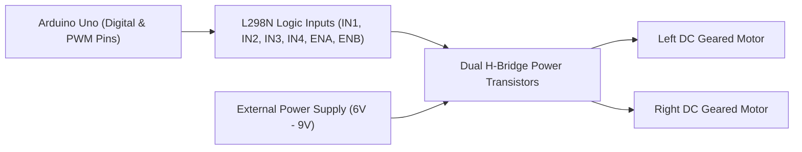

# Project 16: Dual DC Motor Speed & Direction Controller with L298N

**Track:** Robotics, Motors & Wireless Control  
**Difficulty Level:** Intermediate (Grades 7–10)  
**Estimated Time:** 60 Minutes  
**Target Group:** 2 Students  

---

## 1. Project Overview
Electric motors cannot be connected directly to microcontroller pins because microcontrollers can only output 20–40 milliamps of current, whereas DC motors require hundreds of milliamps. In this project, students learn the fundamentals of motor drivers by wiring an L298N dual H-bridge module to control two TT geared motors. Students program forward, reverse, differential turning, and gradual acceleration/deceleration using 8-bit Pulse Width Modulation (PWM).



---

## 2. Learning Objectives (STEM Concepts)
- **Electromagnetism:** Lorentz force, brushed DC motor commutators, back-electromotive force (Back-EMF).
- **H-Bridge Architecture:** Four-quadrant transistor switching to reverse motor polarity electronically without manual switches.
- **Pulse Width Modulation (PWM):** Controlling effective voltage through high-frequency duty-cycle modulation (`analogWrite(0 to 255)`).

---

## 3. Bill of Materials
| Item | Quantity | Source / Link |
| :--- | :---: | :--- |
| Arduino Compatible Uno R3 | 1 | [Duino.lk Uno R3](https://www.duino.lk/product/arduino-compatible-r3-atmega328p-ch340g/) |
| L298N Dual H-Bridge Motor Driver Module | 1 | [Duino.lk L298N](https://www.duino.lk/product/l298n-dual-h-bridge-dc-stepper-motor-driver/) |
| TT Geared DC Motors & Wheels | 2 | [Duino.lk Smart Car Kit](https://www.duino.lk/product/duino-obstacle-avoidance-smart-robot-car-kit/) |
| 5V/3.3V Dedicated Breadboard Power Supply Module | 1 | [Duino.lk Power Module](https://www.duino.lk/product/5v-3-3v-breadboard-dedicated-power-module/) |
| 9V Battery Snap Connector | 1 | [Duino.lk 9V Snap](https://www.duino.lk/product/9v-battery-snap-on-connector-clip/) |
| Male to Female Jumper Wires | 6 | [Duino.lk Jumper Wires](https://www.duino.lk/product/jumper-wire-male-to-female-20cm-40pcs/) |

---

## 4. Hardware Wiring & Pinout Table

> [!WARNING]
> Always connect the Arduino **GND** to the L298N **GND** terminal. A common ground reference is strictly required for logic control signals to work.

| L298N Driver Terminal | Connection Destination | Signal Description |
| :--- | :--- | :--- |
| **+12V (Power Terminal)**| External Battery (+) | Motor Power (6V–9V) |
| **GND** | Battery (-) AND Arduino **GND** | Common Ground Reference |
| **+5V (Onboard Regulator)** | Left unconnected (or to Arduino 5V if powering Uno) | Logic Power |
| **ENA (Enable A)** | Arduino **D5** (PWM) | Left Motor Speed (0–255) |
| **IN1** | Arduino **D7** | Left Motor Direction Bit 1 |
| **IN2** | Arduino **D8** | Left Motor Direction Bit 2 |
| **IN3** | Arduino **D9** | Right Motor Direction Bit 1 |
| **IN4** | Arduino **D10** | Right Motor Direction Bit 2 |
| **ENB (Enable B)** | Arduino **D6** (PWM) | Right Motor Speed (0–255) |
| **OUT1 & OUT2** | Motor A (Left Motor Leads) | Motor A Terminals |
| **OUT3 & OUT4** | Motor B (Right Motor Leads) | Motor B Terminals |

---

## 5. Arduino C++ Source Code

```cpp
/*
 * Project 16: Dual DC Motor Speed & Direction Controller with L298N
 * Club: School Electronics & Innovation Club
 */

const int ENA = 5;  // Left motor speed (PWM)
const int IN1 = 7;  // Left motor dir 1
const int IN2 = 8;  // Left motor dir 2
const int IN3 = 9;  // Right motor dir 1
const int IN4 = 10; // Right motor dir 2
const int ENB = 6;  // Right motor speed (PWM)

void setLeftMotor(int speed, bool forward) {
  analogWrite(ENA, speed);
  digitalWrite(IN1, forward ? HIGH : LOW);
  digitalWrite(IN2, forward ? LOW : HIGH);
}

void setRightMotor(int speed, bool forward) {
  analogWrite(ENB, speed);
  digitalWrite(IN3, forward ? HIGH : LOW);
  digitalWrite(IN4, forward ? LOW : HIGH);
}

void stopMotors() {
  analogWrite(ENA, 0);
  analogWrite(ENB, 0);
  digitalWrite(IN1, LOW);
  digitalWrite(IN2, LOW);
  digitalWrite(IN3, LOW);
  digitalWrite(IN4, LOW);
}

void setup() {
  pinMode(ENA, OUTPUT);
  pinMode(IN1, OUTPUT);
  pinMode(IN2, OUTPUT);
  pinMode(IN3, OUTPUT);
  pinMode(IN4, OUTPUT);
  pinMode(ENB, OUTPUT);

  Serial.begin(9600);
  Serial.println("Dual Motor Test Bench Initialized.");
}

void loop() {
  Serial.println("Ramping Forward (Accelerating 0 to 255)...");
  for (int spd = 80; spd <= 255; spd += 20) {
    setLeftMotor(spd, true);
    setRightMotor(spd, true);
    delay(200);
  }
  delay(1500);

  Serial.println("Braking...");
  stopMotors();
  delay(1000);

  Serial.println("Spin Turn Right (Differential Drive)...");
  setLeftMotor(180, true);
  setRightMotor(180, false);
  delay(1500);

  stopMotors();
  delay(1000);

  Serial.println("Reverse Speed 150...");
  setLeftMotor(150, false);
  setRightMotor(150, false);
  delay(1500);

  stopMotors();
  delay(2000);
}
```

---

## 6. Innovation Challenges
1. **Ramp Control:** Write an acceleration curve formula so the vehicle never jerks abruptly, simulating smooth electric vehicle throttle response.
