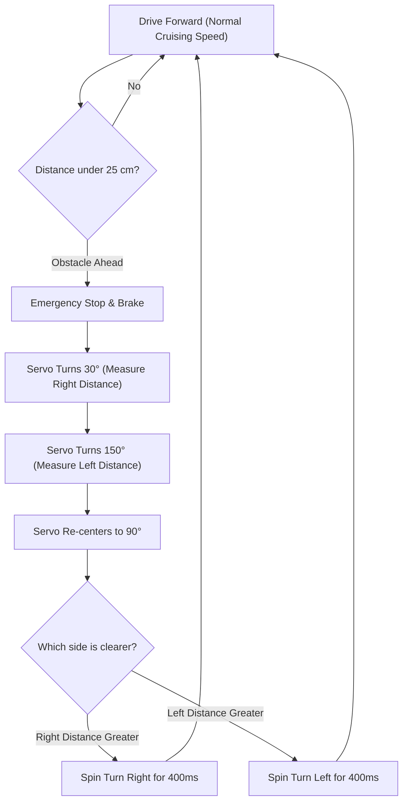

# Project 17: Autonomous Obstacle-Avoiding Smart Rover

**Track:** Robotics, Motors & Wireless Control  
**Difficulty Level:** Advanced (Grades 8–11)  
**Estimated Time:** 90–120 Minutes  
**Target Group:** 2–3 Students  

---

## 1. Project Overview
Building a self-navigating autonomous mobile robot is the premier capstone project of any school innovation club. In this project, students assemble the 2WD robot chassis with an Arduino Uno, L298N driver, and an HC-SR04 ultrasonic sensor mounted atop an SG90 panning servo motor. As the rover navigates an obstacle course, it drives forward until detecting a barrier. It then pauses, sweeps its sonar "head" 60 degrees left and 60 degrees right, evaluates which side offers the widest corridor, steers toward freedom, and resumes roaming!



---

## 2. Learning Objectives (STEM Concepts)
- **Autonomous Robotics:** Sensor fusion, environmental mapping, reactive navigation algorithms.
- **Kinematics of Differential Drive:** Turning radius calculation, wheel slip vs. traction.
- **System Integration:** Mechanical chassis assembly, balancing center of gravity, battery voltage drops under motor load.

---

## 3. Bill of Materials
| Item | Quantity | Source / Link |
| :--- | :---: | :--- |
| Duino Smart Robot Car Chassis Kit | 1 | [Duino.lk Robot Kit](https://www.duino.lk/product/duino-obstacle-avoidance-smart-robot-car-kit/) |
| Arduino Compatible Uno R3 | 1 | [Duino.lk Uno R3](https://www.duino.lk/product/arduino-compatible-r3-atmega328p-ch340g/) |
| L298N Dual H-Bridge Motor Driver Module | 1 | [Duino.lk L298N](https://www.duino.lk/product/l298n-dual-h-bridge-dc-stepper-motor-driver/) |
| HC-SR04 Ultrasonic Distance Sensor | 1 | [Duino.lk HC-SR04](https://www.duino.lk/product/ultrasonic-distance-measuring-transducer/) |
| SG90 9g Micro Servo Motor | 1 | [Duino.lk SG90 Servo](https://www.duino.lk/product/servo-motor-sg90-9g/) |
| 60W Hot Melt Glue Gun (to mount servo & sensor) | 1 | [Duino.lk Glue Gun](https://www.duino.lk/product/60w-glue-gun-nozzle-sd-a6/) |
| 9V Battery Snap Connector | 1 | [Duino.lk 9V Snap](https://www.duino.lk/product/9v-battery-snap-on-connector-clip/) |
| Jumper Wires Male-to-Female | 10 | [Duino.lk Jumper Wires](https://www.duino.lk/product/jumper-wire-male-to-female-20cm-40pcs/) |

---

## 4. Hardware Wiring & Pinout Table

| Function | Pin Connection |
| :--- | :--- |
| **L298N ENA / ENB** | Arduino **D5** / **D6** (PWM Speed Control) |
| **L298N IN1, IN2, IN3, IN4** | Arduino **D7, D8, D9, D10** |
| **HC-SR04 TRIG / ECHO** | Arduino **D12** / **D13** |
| **Panning SG90 Servo PWM** | Arduino **D11** |
| **Motor Battery Supply** | 4x AA Battery Holder (or 9V) to L298N +12V & GND |
| **Arduino Power** | Vin & GND connected from L298N terminal blocks |

---

## 5. Arduino C++ Source Code

```cpp
/*
 * Project 17: Autonomous Obstacle-Avoiding Smart Rover
 * Club: School Electronics & Innovation Club
 */

#include <Servo.h>

const int ENA = 5;
const int ENB = 6;
const int IN1 = 7;
const int IN2 = 8;
const int IN3 = 9;
const int IN4 = 10;

const int TRIG_PIN  = 12;
const int ECHO_PIN  = 13;
const int SERVO_PIN = 11;

const int OBSTACLE_LIMIT = 25; // Stop when object is closer than 25cm
const int MOTOR_SPEED    = 180; // Default cruising speed (0-255)

Servo neckServo;

float pingDistance() {
  digitalWrite(TRIG_PIN, LOW);
  delayMicroseconds(2);
  digitalWrite(TRIG_PIN, HIGH);
  delayMicroseconds(10);
  digitalWrite(TRIG_PIN, LOW);

  long duration = pulseIn(ECHO_PIN, HIGH, 25000);
  if (duration == 0) return 300.0;
  return (duration * 0.0343) / 2.0;
}

void forward() {
  analogWrite(ENA, MOTOR_SPEED);
  analogWrite(ENB, MOTOR_SPEED);
  digitalWrite(IN1, HIGH);
  digitalWrite(IN2, LOW);
  digitalWrite(IN3, HIGH);
  digitalWrite(IN4, LOW);
}

void reverse() {
  analogWrite(ENA, MOTOR_SPEED);
  analogWrite(ENB, MOTOR_SPEED);
  digitalWrite(IN1, LOW);
  digitalWrite(IN2, HIGH);
  digitalWrite(IN3, LOW);
  digitalWrite(IN4, HIGH);
}

void turnLeft(int ms) {
  analogWrite(ENA, MOTOR_SPEED);
  analogWrite(ENB, MOTOR_SPEED);
  digitalWrite(IN1, LOW);
  digitalWrite(IN2, HIGH);
  digitalWrite(IN3, HIGH);
  digitalWrite(IN4, LOW);
  delay(ms);
}

void turnRight(int ms) {
  analogWrite(ENA, MOTOR_SPEED);
  analogWrite(ENB, MOTOR_SPEED);
  digitalWrite(IN1, HIGH);
  digitalWrite(IN2, LOW);
  digitalWrite(IN3, LOW);
  digitalWrite(IN4, HIGH);
  delay(ms);
}

void stopCar() {
  analogWrite(ENA, 0);
  analogWrite(ENB, 0);
  digitalWrite(IN1, LOW);
  digitalWrite(IN2, LOW);
  digitalWrite(IN3, LOW);
  digitalWrite(IN4, LOW);
}

void setup() {
  pinMode(ENA, OUTPUT);
  pinMode(ENB, OUTPUT);
  pinMode(IN1, OUTPUT);
  pinMode(IN2, OUTPUT);
  pinMode(IN3, OUTPUT);
  pinMode(IN4, OUTPUT);
  pinMode(TRIG_PIN, OUTPUT);
  pinMode(ECHO_PIN, INPUT);

  neckServo.attach(SERVO_PIN);
  neckServo.write(90); // Look straight ahead
  delay(500);

  Serial.begin(9600);
  Serial.println("Autonomous Rover Initialized.");
  delay(2000); // 2 second pause before driving
}

void loop() {
  float distanceAhead = pingDistance();

  if (distanceAhead > OBSTACLE_LIMIT) {
    forward();
    delay(50);
  } else {
    // Obstacle detected!
    stopCar();
    delay(200);

    // Back up slightly
    reverse();
    delay(300);
    stopCar();

    // Look Right (30 degrees)
    neckServo.write(30);
    delay(400);
    float distRight = pingDistance();

    // Look Left (150 degrees)
    neckServo.write(150);
    delay(500);
    float distLeft = pingDistance();

    // Return to Center
    neckServo.write(90);
    delay(300);

    // Evaluate best direction
    if (distRight >= distLeft && distRight > 20) {
      turnRight(450); // Spin right
    } else if (distLeft > distRight && distLeft > 20) {
      turnLeft(450);  // Spin left
    } else {
      turnRight(900); // Dead-end trapped: 180 degree U-turn
    }
  }
}
```

---

## 6. Testing in a Maze
1. Construct an obstacle maze in the classroom using cardboard boxes and school bags.
2. Place the rover on the floor and turn on battery power.
3. Observe how the rover roams gracefully, stopping cleanly 25cm before impact and scanning both ways before deciding its escape route!

---

## 7. Innovation Challenges
1. **Horn & Warning Siren:** Incorporate the piezo buzzer so the robot sounds a short beep whenever it shifts into reverse!
