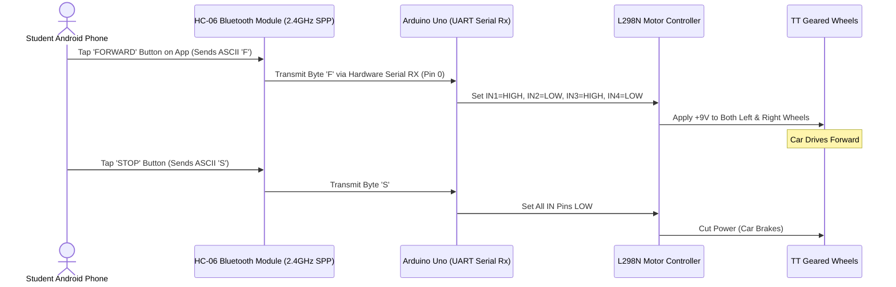

# Project 18: Bluetooth Smartphone Remote-Controlled Car

**Track:** Robotics, Motors & Wireless Control  
**Difficulty Level:** Advanced (Grades 8–11)  
**Estimated Time:** 90 Minutes  
**Target Group:** 2–3 Students  

---

## 1. Project Overview
Upgrading an autonomous rover to a wireless, remote-controlled vehicle is a thrilling club experience. In this project, students interface an HC-06 Bluetooth module to the robot car from Project 17. By pairing an Android smartphone running a free Bluetooth Controller app, students wirelessly steer the car using touch buttons, an on-screen joystick, or phone tilt gyroscopes!



---

## 2. Learning Objectives (STEM Concepts)
- **Wireless Telemetry:** The Bluetooth Serial Port Profile (SPP), baud rate synchronization (9600 bps), packet stream parsing.
- **UART Serial Communication:** Asynchronous serial framing, Start/Stop bits, logic level voltage considerations (5V vs 3.3V).
- **Mobile-Embedded Interfacing:** Designing custom human-machine interfaces (HMI) on smartphones.

---

## 3. Bill of Materials
| Item | Quantity | Source / Link |
| :--- | :---: | :--- |
| Duino Smart Robot Car Chassis Kit | 1 | [Duino.lk Robot Kit](https://www.duino.lk/product/duino-obstacle-avoidance-smart-robot-car-kit/) |
| Arduino Compatible Uno R3 | 1 | [Duino.lk Uno R3](https://www.duino.lk/product/arduino-compatible-r3-atmega328p-ch340g/) |
| L298N Dual H-Bridge Motor Driver Module | 1 | [Duino.lk L298N](https://www.duino.lk/product/l298n-dual-h-bridge-dc-stepper-motor-driver/) |
| HC-06 Bluetooth Transceiver Module | 1 | [Duino.lk HC-06](https://www.duino.lk/product/hc-06-bluetooth-rf-transceiver-module-slave/) |
| 1kΩ & 2kΩ Resistors (for 3.3V RX Voltage Divider) | 2 | [Duino.lk Resistors](https://www.duino.lk/product/2k-ohm-1-4w-smd-resistor-1206/) |
| 9V Battery Snap Connector | 1 | [Duino.lk 9V Snap](https://www.duino.lk/product/9v-battery-snap-on-connector-clip/) |
| Male to Female Jumper Wires | 6 | [Duino.lk Jumper Wires](https://www.duino.lk/product/jumper-wire-male-to-female-20cm-40pcs/) |

---

## 4. Hardware Wiring Table

> [!IMPORTANT]
> Temporarily disconnect the **RX** wire from the Arduino while uploading code, because Arduino's USB programmer shares the hardware Serial RX pin (Pin 0)! Reconnect after flashing.

| HC-06 Module Pin | Arduino Uno Pin | Purpose |
| :--- | :--- | :--- |
| **VCC** | 5V | Bluetooth module power |
| **GND** | GND | Common ground |
| **TXD** | Pin **D0 (RX)** | Transmits received Bluetooth bytes into Arduino |
| **RXD** | Pin **D1 (TX)** via voltage divider | Receives data from Arduino (3.3V logic) |

---

## 5. Arduino C++ Source Code

```cpp
/*
 * Project 18: Bluetooth Smartphone Remote-Controlled Car
 * Club: School Electronics & Innovation Club
 */

const int ENA = 5;
const int ENB = 6;
const int IN1 = 7;
const int IN2 = 8;
const int IN3 = 9;
const int IN4 = 10;

int currentSpeed = 200; // Default speed (0-255)

void setup() {
  pinMode(ENA, OUTPUT);
  pinMode(ENB, OUTPUT);
  pinMode(IN1, OUTPUT);
  pinMode(IN2, OUTPUT);
  pinMode(IN3, OUTPUT);
  pinMode(IN4, OUTPUT);

  // Initialize hardware serial for HC-06 Bluetooth
  Serial.begin(9600);
}

void loop() {
  if (Serial.available() > 0) {
    char cmd = Serial.read();

    switch (cmd) {
      case 'F': // Move Forward
        analogWrite(ENA, currentSpeed);
        analogWrite(ENB, currentSpeed);
        digitalWrite(IN1, HIGH);
        digitalWrite(IN2, LOW);
        digitalWrite(IN3, HIGH);
        digitalWrite(IN4, LOW);
        break;

      case 'B': // Move Backwards
        analogWrite(ENA, currentSpeed);
        analogWrite(ENB, currentSpeed);
        digitalWrite(IN1, LOW);
        digitalWrite(IN2, HIGH);
        digitalWrite(IN3, LOW);
        digitalWrite(IN4, HIGH);
        break;

      case 'L': // Turn Left
        analogWrite(ENA, currentSpeed);
        analogWrite(ENB, currentSpeed);
        digitalWrite(IN1, LOW);
        digitalWrite(IN2, HIGH);
        digitalWrite(IN3, HIGH);
        digitalWrite(IN4, LOW);
        break;

      case 'R': // Turn Right
        analogWrite(ENA, currentSpeed);
        analogWrite(ENB, currentSpeed);
        digitalWrite(IN1, HIGH);
        digitalWrite(IN2, LOW);
        digitalWrite(IN3, LOW);
        digitalWrite(IN4, HIGH);
        break;

      case 'S': // Stop
      default:
        analogWrite(ENA, 0);
        analogWrite(ENB, 0);
        digitalWrite(IN1, LOW);
        digitalWrite(IN2, LOW);
        digitalWrite(IN3, LOW);
        digitalWrite(IN4, LOW);
        break;
    }
  }
}
```

---

## 6. Smartphone Setup & Pairing
1. On your Android phone, go to **Settings > Bluetooth** and search for new devices.
2. Select **HC-06** and enter the default pairing PIN code: **`1234`** (or `0000`).
3. Download any standard free app such as *"Arduino Bluetooth Controller"* or *"Bluetooth RC Controller"* from Google Play.
4. Connect to HC-06 in the app, and drive your robot across the club floor!

---

## 7. Innovation Challenges
1. **Horn Button:** Program character `'V'` to sound the piezo buzzer like an automobile horn!
