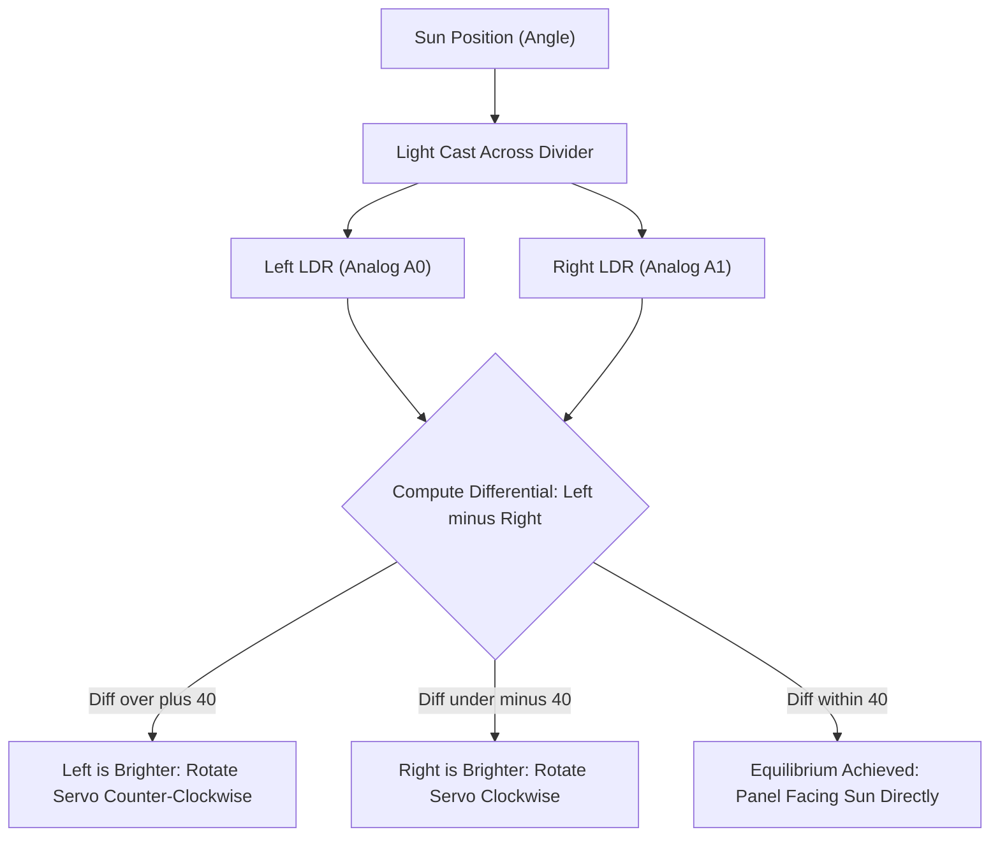

# Project 19: Dual-LDR Single-Axis Solar Tracker

**Track:** Robotics, Renewable Energy & Mechatronics  
**Difficulty Level:** Advanced (Grades 8–11)  
**Estimated Time:** 75 Minutes  
**Target Group:** 2 Students  

---

## 1. Project Overview
Solar photovoltaic panels generate up to 30% more daily electrical energy when equipped with active tracking systems that follow the sun from dawn to dusk. In this project, students build a working sun-seeking solar tracker. Two LDR (photoresistor) sensors separated by a cardboard shadow divider compare light levels on the left and right. An Arduino Nano computes the differential error and adjusts an SG90 servo motor until both sensors receive equal illumination!



---

## 2. Learning Objectives (STEM Concepts)
- **Renewable Green Energy:** Solar irradiance, solar zenith angle, efficiency losses from cosine angular misalignment.
- **Closed-Loop Feedback Control:** Error calculation ($\Delta E = LDR_{left} - LDR_{right}$), deadband thresholding to eliminate mechanical oscillations.
- **Mechatronics:** Proportional rotational positioning using servo actuation.

---

## 3. Bill of Materials
| Item | Quantity | Source / Link |
| :--- | :---: | :--- |
| Arduino Compatible Nano V3.0 | 1 | [Duino.lk Nano V3.0](https://www.duino.lk/product/arduino-compatible-nano-v3-0/) |
| LDR Light Sensitive Sensor Modules | 2 | [Duino.lk LDR Modules](https://www.duino.lk/product/photoresistor-ldr-light-sensitive-sensor-module/) |
| SG90 9g Micro Servo Motor | 1 | [Duino.lk SG90 Servo](https://www.duino.lk/product/servo-motor-sg90-9g/) |
| Breadboard 830 Tie Point | 1 | [Duino.lk Breadboard 830](https://www.duino.lk/product/breadboard-830-tie-point-16-5x5-5x0-85-cm/) |
| 60W Hot Melt Glue Gun & Cardboard | 1 | [Duino.lk Glue Gun](https://www.duino.lk/product/60w-glue-gun-nozzle-sd-a6/) |
| Male to Female Jumper Wires | 8 | [Duino.lk Jumper Wires](https://www.duino.lk/product/jumper-wire-male-to-female-20cm-40pcs/) |

---

## 4. Hardware Wiring & Pinout Table

| Component Pin | Arduino Nano Pin | Notes |
| :--- | :--- | :--- |
| **Left LDR Module A0** | Analog Pin **A0** | Left light measurement |
| **Right LDR Module A0** | Analog Pin **A1** | Right light measurement |
| **SG90 Servo PWM** | Digital Pin **D9** | Servo rotation control |
| **All Module VCCs** | 5V Rail | Regulated +5V |
| **All Module GNDs** | GND Rail | Common ground |

---

## 5. Arduino C++ Source Code

```cpp
/*
 * Project 19: Dual-LDR Single-Axis Solar Tracker
 * Club: School Electronics & Innovation Club
 */

#include <Servo.h>

const int PIN_LDR_LEFT  = A0;
const int PIN_LDR_RIGHT = A1;
const int PIN_SERVO     = 9;

const int TOLERANCE = 40; // Deadband to prevent servo jitter
int servoPosition = 90;   // Start pointing straight up at 90 degrees

Servo trackerServo;

void setup() {
  trackerServo.attach(PIN_SERVO);
  trackerServo.write(servoPosition);
  delay(500);

  Serial.begin(9600);
  Serial.println("Solar Tracker Initialized. Searching for sun...");
}

void loop() {
  int leftLight  = analogRead(PIN_LDR_LEFT);
  int rightLight = analogRead(PIN_LDR_RIGHT);

  int diff = leftLight - rightLight;

  Serial.print("Left: "); Serial.print(leftLight);
  Serial.print(" | Right: "); Serial.print(rightLight);
  Serial.print(" | Diff: "); Serial.println(diff);

  // If left side has significantly more light, turn left
  if (diff > TOLERANCE) {
    if (servoPosition > 10) {
      servoPosition -= 2;
      trackerServo.write(servoPosition);
      delay(30);
    }
  }
  // If right side has significantly more light, turn right
  else if (diff < -TOLERANCE) {
    if (servoPosition < 170) {
      servoPosition += 2;
      trackerServo.write(servoPosition);
      delay(30);
    }
  }

  delay(60); // Tracking speed
}
```

---

## 6. Physical Construction & Testing
1. Cut a 5cm × 5cm cardboard platform and hot-glue the two LDR modules side by side.
2. Glue a vertical cardboard partition (the "shadow vane") exactly between the two LDRs.
3. Glue the platform to the horn of the SG90 servo motor.
4. Turn on a smartphone flashlight across the room: watch the tracker smoothly pivot its face to lock directly onto the beam! Move the light across the table—the tracker follows your flashlight continuously!

---

## 7. Innovation Challenges
1. **Sleep Mode at Night:** If both LDR readings drop below 100 (total darkness), have the servo automatically swing back to East (0 degrees) to await the morning dawn!
