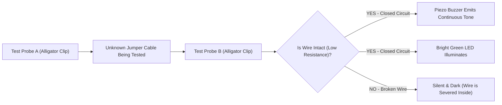

# Project 20: Soldering Workshop 101 – Permanent LED Continuity Tester Box

**Track:** Workshop Tools, Soldering & Fabrication  
**Difficulty Level:** Intermediate (Grades 7–11)  
**Estimated Time:** 90 Minutes  
**Target Group:** 2 Students  

---

## 1. Project Overview
Breadboard circuits are wonderful for quick experiments, but permanent electronics must be soldered to withstand physical handling. In this hands-on workshop project, students transition from breadboarding to permanent assembly by building a pocket **Audio-Visual Cable Continuity Tester Box**. Students use the club's 60W temperature-controlled soldering iron, rosin-core solder wire, wire strippers, and multimeter to assemble a durable testing tool the club will keep and use to inspect broken jumper wires!



---

## 2. Learning Objectives (STEM Concepts)
- **Metallurgy & Wetting:** Eutectic solder alloy flow, wetting angles, flux oxidation cleaning, thermal mass.
- **Electrical Quality Assurance:** Cold solder joints vs. shiny concave solder fillets, continuity resistance testing (< 1Ω).
- **Workshop Safety & Ergonomics:** Safe tool handling, ventilation, desoldering pump correction techniques.

---

## 3. Bill of Materials
| Item | Quantity | Source / Link |
| :--- | :---: | :--- |
| Soldering Iron Kit 60W Adjustable with Accessories | 1 | [Duino.lk Soldering Iron Kit](https://www.duino.lk/product/soldering-iron-kit-60w-adjustable-with-accessories/) |
| 60W Electric Desoldering Pump Sucker CJ-019X | 1 | [Duino.lk Desoldering Pump](https://www.duino.lk/product/60w-electric-desoldering-pump/) |
| Solder Wire 1.0mm 100g Spool | 1 | [Duino.lk Solder Wire](https://www.duino.lk/product/solder-wire-1-0mm-tin-welding-wires-100g/) |
| Wire Stripper Crimper Cutter Pliers 10-22 AWG | 1 | [Duino.lk Wire Stripper](https://www.duino.lk/product/wire-stripper-crimper-cutter-pliers/) |
| Digital Multimeter DT-830D with Probes | 1 | [Duino.lk Multimeter](https://www.duino.lk/product/digital-multimeter-dt-830d/) |
| 60W Hot Melt Glue Gun | 1 | [Duino.lk Glue Gun](https://www.duino.lk/product/60w-glue-gun-nozzle-sd-a6/) |
| 5mm Green LED | 1 | [Duino.lk LEDs](https://www.duino.lk/product/1000pcs-3mm-red-water-clear-led-1-9-2-1vdc-packet/) |
| 220Ω Resistor | 1 | [Duino.lk Resistors](https://www.duino.lk/product/2k-ohm-1-4w-smd-resistor-1206/) |
| Piezo Electronic Buzzer | 1 | [Duino.lk Buzzer](https://www.duino.lk/product/dc-3-24v-electronic-buzzer/) |
| 9V Battery Snap Connector | 1 | [Duino.lk 9V Snap](https://www.duino.lk/product/9v-battery-snap-on-connector-clip/) |
| Small Plastic Container / Enclosure | 1 | Included with O/L ICT Kit or recycled pill container |

---

## 4. Schematic Circuit

```
   9V Battery (+) ---> [Probe A Terminal]
   
   [Probe B Terminal] ---> (+) Green LED (-) ---> [220 Ohm] ---> 9V Battery (-)
                      ---> (+) Piezo Buzzer (-) -------------> 9V Battery (-)
```

When Probe A touches Probe B (or touches both ends of a healthy jumper wire), current flows through the circuit: the green LED illuminates brightly and the buzzer sounds. If the wire is broken inside its plastic sleeve, nothing happens.

---

## 5. Step-by-Step Soldering Instructions

### Phase 1: Soldering Station Preparation
1. Place the metal safety stand firmly on the workbench.
2. Dampen the cleaning sponge with a small splash of water (damp, not soaking wet).
3. Plug in the 60W soldering iron and adjust the temperature dial to **350°C**. Wait 90 seconds.
4. **Tinning the Tip:** Touch rosin-core solder wire to the hot iron tip until a small bead of shiny solder coats the tip. Wipe excess on the damp sponge. A shiny tip transfers heat efficiently.

### Phase 2: Splicing & Assembly
1. Use the [Wire Stripper Pliers](https://www.duino.lk/product/wire-stripper-crimper-cutter-pliers/) to strip 8mm of insulation from the 9V battery snap leads.
2. Twist the red lead of the 9V snap to the Probe A wire. Apply the hot soldering iron tip to heat both wires simultaneously for 2 seconds, then feed solder wire into the joint until it flows smoothly between the copper strands.
3. Solder the 220Ω resistor to the Cathode (short leg) of the Green LED.
4. Solder the Buzzer in parallel with the LED/resistor branch.
5. Use the [60W Electric Desoldering Pump](https://www.duino.lk/product/60w-electric-desoldering-pump/) if any joint needs clean removal or re-aligning.

### Phase 3: Enclosure & Quality Assurance
1. Use the [Digital Multimeter DT-830D](https://www.duino.lk/product/digital-multimeter-dt-830d/) set to continuity mode (buzzer symbol) to verify zero resistance across all soldered joints before powering.
2. Mount the components into a neat small plastic enclosure using the hot glue gun with the test probes protruding out through drilled holes.
3. Label the tool: `"CLUB CABLE TESTER #1"`.

---

## 6. Safety Checklist
- [ ] Safety goggles worn at all times.
- [ ] Soldering iron returned to the metal stand immediately after each joint.
- [ ] Never touch the hot metallic barrel (reaches 350°C+).
- [ ] Wash hands with soap and water after handling solder.
